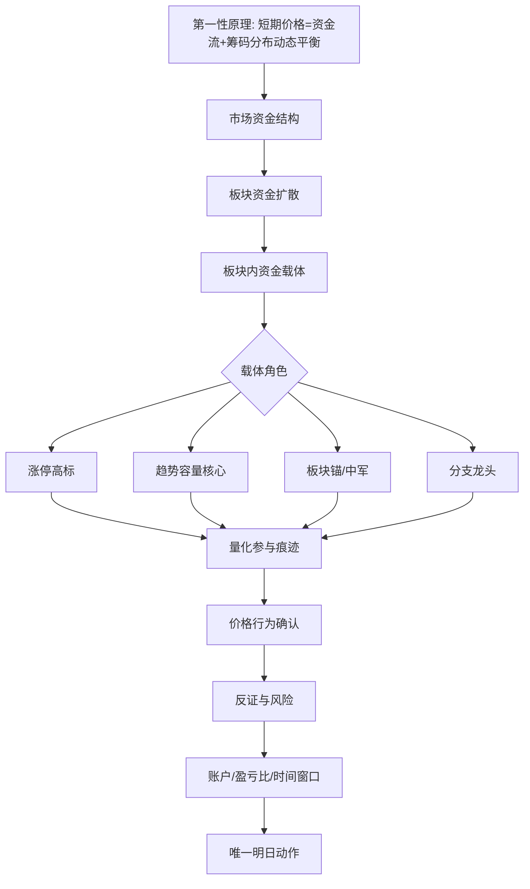

# Daily Report Decision Loop

> The daily report is the ship; quantitative work is the instrument panel. Do not reverse that relationship.

## Purpose

The daily report must evolve from a readable market explanation into an auditable trading decision system. Every optimization should strengthen the loop:

1. produce a judgment,
2. rehearse tomorrow's participation plan,
3. review whether the rehearsal worked,
4. revise one rule or condition from the evidence.

The report should not become a traditional fully automated strategy first. Quantification serves the existing decision surface by measuring whether its judgments, windows, samples, and position choices actually worked.

## In Scope

- Daily report structure and backend payload contracts for decision review.
- Judgment ledger fields for mainline evidence, participation windows, sample tiers, position choices, review labels, and short-horizon performance.
- Rules for converting qualitative trading judgment into auditable fields.
- Replay behavior for historical reports, including same-date facts and explicit missing-data labels.
- Acceptance checks that keep final action, process evidence, and review evidence separated.
- Historical coverage metadata for every review/statistics surface.

## Out Of Scope

- A fully automated buy/sell system.
- Factor mining, broad backtesting framework work, broker execution, trade-cost modeling, or live-trading stability work.
- Replacing the existing report contract, reasoning contract, or mainline attack evidence design.
- Adding new data sources only for future metrics before the current loop can review existing judgments.
- Claiming 60/120-day review evidence when the source facts do not cover those windows.

## Non-goals

- Do not make score output look more certain than the underlying facts.
- Do not let performance statistics create a new trade action when the original report did not provide a valid participation plan.
- Do not collapse stock selection quality, buy-point quality, missed-entry handling, and risk-reward into one success label.
- Do not optimize wording while leaving the judgment unreviewable.
- Do not hide a short sample behind long-window wording.

## Done Definition

A report optimization follows this spec when:

- The front page can answer: participation qualification, mainline, tomorrow action, cancellation condition, and prior rehearsal result.
- Each high-conviction item has a machine-readable planned participation record.
- Each reviewed item has an explicit review label derived from next-day facts.
- Ledger records can compute 1-day, 3-day, and 5-day follow-up performance without using current-day facts for historical dates.
- Replay output states which fields came from official snapshots, which came from target-date refill, and which remain missing.
- Statistics and tracking surfaces state the true sample count and covered date range.

## Current Historical Coverage Rule

As of `2026-06-02`, the repository has:

- 42 official full daily reports from `2026-03-31` through `2026-06-01`.
- 41 official snapshots from `2026-04-01` through `2026-06-01`.
- 36 replay full reports from `2026-04-03` through `2026-06-01`.

Any report or statistics surface may summarize only the rows that are actually present and auditable. If the underlying data covers 25, 36, 41, or 42 trading days, the rendered text must say that exact scope or use a neutral phrase such as "current covered sample".

60-day and 120-day windows are expansion targets. They are allowed only after source facts and settlement rows cover those windows. Until then, write the window as a target or missing coverage, not as current evidence.

## Scenario: Decision Loop Contract

### 1. Scope / Trigger

Use this contract when changing:

- daily report front-page conclusions,
- action-plan rendering,
- decision-ledger records,
- participation review logic,
- replay report reconstruction,
- quantification or dashboard metrics derived from report judgments.

### 2. Signatures

#### `decision_ledger_record.v1`

```python
{
    "schema_version": "decision_ledger_record.v1",
    "report_date": "YYYY-MM-DD",
    "source_report_path": "reports/...md",
    "market_participation_qualification": "qualified | not_qualified | incomplete",
    "position_plan_pct": 0 | 50 | 100,
    "position_plan_label": "0%不参与 | 50%标准进攻 | 100%核心进攻",
    "mainline": "str | None",
    "mainline_attack_evidence_score": "int 0..5 | None",
    "mainline_attack_evidence_labels": ["str"],
    "sample_tier": "high | middle | low | missed | observation | old_position",
    "trend_chain_position": "leader | same_chain | laggard | crossline | unknown",
    "old_position_plan": "old_position_plan.v1 | None",
    "planned_participation": "planned_participation.v1 | None",
    "cancellation_conditions": ["str"],
    "source_dates": {
        "snapshot_date": "YYYY-MM-DD | None",
        "refill_date": "YYYY-MM-DD | None",
        "price_source_date": "YYYY-MM-DD | None"
    },
    "missing_fields": ["str"]
}
```

#### `old_position_plan.v1`

Use this when the user provides a current holding, especially when the final
new-entry result is 0%.

```python
{
    "schema_version": "old_position_plan.v1",
    "holding": {"code": "str", "name": "str", "position_pct": "int | None"},
    "account_exposure_mode": "0x | 1x | 2x | unknown",
    "position_sizing_rule": "position_tier | unknown",
    "trade_role": "old_position | tplus2_exit | failed_buy | unknown",
    "risk_reward_assessment": "favorable | neutral | unfavorable | incomplete",
    "relative_strength_basis": "str",
    "rebound_exit_zone": "str | None",
    "invalidation_lines": ["str"],
    "tail_exit_allowed": "bool",
    "tail_exit_condition": "str",
    "action": "hold | reduce | exit | wait_for_repair",
    "evidence_sources": ["str"],
    "decision_class": "failed | review_at_10_10 | normal | incomplete",
    "primary_action_window": "09:50-10:10 | 14:30-14:55 | none",
    "review_conditions": ["str"],
    "closing_target_position_pct": "int | None"
}
```

#### `position_tier_exposure.v2`

```python
{
    "schema_version": "position_tier_exposure.v2",
    "position_fact_status": "confirmed | pending_confirmation | none | unknown",
    "old_position_pct": "0 | 50 | 100 | None",
    "old_position_x": "0 | 1 | 2 | None",
    "planned_new_entry_pct": "0 | 50 | 100",
    "planned_new_entry_x": "0 | 1 | 2",
    "new_entry_pct": "0 | 50 | 100",
    "new_entry_x": "0 | 1 | 2",
    "same_stock_target": "bool",
    "same_stock_t": "bool",
    "possible_intraday_overlap": "bool",
    "max_runtime_exposure_pct": "0 | 50 | 100 | None",
    "max_runtime_exposure_x": "0 | 1 | 2 | None",
    # Legacy booleans remain read-compatible but do not own the ratio.
    "old_position_1x": "bool",
    "new_entry_1x": "bool",
    "possible_intraday_overlap_2x": "bool",
    "policy": "str",
    "legacy": {"source_schema_version": "full_or_empty_exposure.v1 | None"},
}
```

#### `tomorrow_account_action.v1`

```python
{
    "schema_version": "tomorrow_account_action.v1",
    "action": "empty",
    "source": "explicit_cli | explicit_input | historical_snapshot | str",
}
```

#### `planned_participation.v1`

```python
{
    "window": "09:30-09:35 | 09:50-10:10 | 14:30-14:55 | no_trade",
    "position_plan_pct": 0 | 50 | 100,
    "action": "participate | wait | skip | reduce | exit",
    "confirm_conditions": ["str"],
    "cancellation_conditions": ["str"],
    "missed_entry_plan": "str | None",
    "invalid_price": "float | str | None",
    "risk_reward_ratio": "float | None"
}
```

#### `participation_review.v1`

```python
{
    "schema_version": "participation_review.v1",
    "report_date": "YYYY-MM-DD",
    "review_date": "YYYY-MM-DD",
    "review_status": "预演命中 | 预演作废 | 错过后方案命中 | 预演过早 | 待补事实",
    "fact_inputs": {
        "auction_matched": "bool | None",
        "first_minutes_accepted": "bool | None",
        "board_sealed": "bool | None",
        "reseal_success": "bool | None",
        "sector_supported": "bool | None",
        "cancellation_triggered": "bool | None",
        "primary_unavailable": "bool | None",
        "missed_action_worked": "bool | None"
    },
    "performance": {
        "return_1d_pct": "float | None",
        "return_3d_pct": "float | None",
        "return_5d_pct": "float | None",
        "max_drawdown_5d_pct": "float | None"
    },
    "missing_fields": ["str"]
}
```

#### `decision_coverage_summary.v1`

```python
{
    "schema_version": "decision_coverage_summary.v1",
    "surface": "tracking | backtest | statistics | probability",
    "sample_count": "int >= 0",
    "start_date": "YYYY-MM-DD | None",
    "end_date": "YYYY-MM-DD | None",
    "available_report_count": "int >= 0",
    "available_snapshot_count": "int >= 0",
    "available_replay_count": "int >= 0",
    "target_window_days": "25 | 60 | 120 | None",
    "coverage_status": "covered | partial | missing",
    "missing_fields": ["str"]
}
```

#### `five_judgment_statistics.v1`

```python
{
    "schema_version": "five_judgment_statistics.v1",
    "sample_count": "int >= 0",
    "missing_fact_count": "int >= 0",
    "start_date": "YYYY-MM-DD | None",
    "end_date": "YYYY-MM-DD | None",
    "rows": [
        {
            "judgment_type": "market_state | mainline | core_candidate | participation_rehearsal | cancellation_condition",
            "label": "str",
            "metric_definition": "str",
            "sample_count": "int >= 0",
            "correct_count": "int >= 0",
            "wrong_count": "int >= 0",
            "missing_fact_count": "int >= 0",
            "accuracy_pct": "float 0..100 | None",
            "start_date": "YYYY-MM-DD | None",
            "end_date": "YYYY-MM-DD | None",
            "latest_mistake": "str",
            "missing_fields": ["str"]
        }
    ]
}
```

### 3. Contracts

- Final action must be easier to find than process evidence.
- Final action must include `position_plan_pct`, a participation window or `no_trade`, confirmation conditions, and cancellation conditions.
- A 0% result is valid only when the report explains no qualified target, weak market, invalid trend chain, failed cancellation condition, account mismatch, old-position handling, or incomplete key data.
- If a current holding is provided, the final action must not describe 0% only
  as no new entry. It must also render an `old_position_plan.v1` with the
  holding, account exposure mode, position sizing rule, trade role,
  risk-reward assessment, rebound exit zone, invalidation lines, whether
  tail-session exit is still allowed, and the evidence source used for that
  judgment.
- The user-facing account action surface must render five independent rows:
  `明日新仓`, `旧仓事实`, `旧仓判断`, `旧仓动作`, and `收盘目标仓位`.
  `明日新仓 0%` does not prove current account exposure is 0x.
- `明日新仓 0%` and `明日标的为空` mean no new participation only. They
  do not create an account-zero instruction and do not override an independently
  confirmed old-position plan. Current empty-position input describes the
  current account fact only; unknown position input keeps exposure and closing
  target pending confirmation.
- Explicit `明日空仓` is the next-day account-zero instruction. It requires no
  new purchase, selling every sellable old position in the opening call auction,
  no same-day T, and account exposure 0 after execution. An unfilled remainder
  stays in the earliest-exit path and must not be described as already empty.
  This explicit instruction overrides the normal `failed`, `review_at_10_10`,
  and `normal` old-position timing rules.
- `source=explicit_cli` belongs only to the command invocation that received
  `--tomorrow-empty`. A later invocation without that option must remove cached
  copies from the root, position decision, final resolution, market snapshot,
  and execution context. Non-CLI historical/replay sources remain valid, and a
  derived `capital_priority=tomorrow_empty` may remain only beside a valid
  preserved instruction.
- `position_fact_status=confirmed` always counts the old position in account
  exposure. `pending_confirmation` remains 0x until a trade fact confirms B1;
  `none` may render 0x; `unknown` renders both exposure and closing target as
  pending confirmation.
- Non-empty position narrative alone is not a confirmed holding fact. Confirm
  only from an explicit position flag, positive actual `position` /
  `position_pct`, a structured old-position plan, or direct holding language.
  Ambiguous notes such as exposure pending review or an unproven prior plan
  remain `unknown` and must not create an old-position action.
- Confirmed old positions use `decision_class`: `failed` exits during
  `09:50-10:10`; `review_at_10_10` checks stock acceptance, relative index
  strength, and sector-wide acceptance once and may defer only when all three
  pass; `normal` uses `14:30-14:55` only when an explicit T+2/tail plan exists;
  `incomplete` must not invent a precise exit time.
- Normalize every structured `old_position_plan.v1` at the account-action
  boundary. Cached `action`, `primary_action_window`, `tail_exit_allowed`,
  `review_conditions`, and `closing_target_position_pct` values must not
  override `decision_class`; legacy rows may derive the class only from the
  explicit roles `failed_buy`, `wait_for_repair`, or `tplus2_exit`.
- `13:45-14:10` remains an end-of-day/replay research range. It must not become
  a new manual action window through old-position handling.
- Position sizing has exactly three tiers: `0 = 0%`, `1x = 50% / B1`, and
  `2x = 100% / B1+B2`. A confirmed B1 is already 1x; B2 may raise the total to
  2x only after confirmation. Two concurrent 1x legs consume 2x / 100% total,
  never 200% exposure.
- New planned-position producers emit only `0`, `50`, or `100`. Actual lot-size
  fills in the `40%-60%` band may be classified as 1x account exposure, but the
  visible plan remains `1x/50%`; do not emit `1x/40%` or `1x/60%` plans.
- In `position_tier_exposure.v2`, `planned_new_entry_pct/x` owns the target's
  total planned tier, while `new_entry_pct/x` owns the current incremental buy
  after subtracting an existing same-stock tier or available account capacity.
  A same-stock 1x holding plus a planned 1x target therefore has current new
  entry 0; a planned 2x target has current new entry 1x and that increment is B2.
- Tail-session exit is allowed only while the holding has not triggered its
  invalidation lines and has not shown sustained relative weakness. If minute
  comparison evidence shows the holding staying materially weaker than the
  index, rebound highs stepping down, or a break of the prior low / planned
  support, the old-position plan must move from tail-session default to rebound
  exit or invalidation exit.
- When a report carries `selection_workflow.derivation_contract = "sector_first_strict.v1"`, the front page and report payload must treat `selection_workflow.final` as the only source of the final execution object. The presence of the `final` key owns this decision even when its value is `{}` or its object is empty. Older `selected_position_candidate` / `unique_action_target` values may remain only as source or historical evidence; they must not reappear as a current execution object, current observation target, or current tracking item.
- When `selection_workflow.final` is empty or final position is 0%, process-candidate action text must be observation-only at every layer: candidate generation, Step 2 tables, action-plan context, appendix tables, final Markdown sanitation, and HTML source text. Phrases such as `命中才参与`, `后再参与`, or `继续强就只做它` are invalid in process-candidate rows under a 0% final result; render `只观察承接，不新增参与` or `只作过程回放，不新增参与` instead.
- Every candidate other than the positive `selection_workflow.final.execution_object` must leave `tentative_items`, `today_tentative_items`, `validated_items`, `today_validated_items`, `new_items`, `promoted_items`, and `reactivated_items`. It may remain in `total_items` and `inactive_items` only as `status=inactive_recall`, with no current action, future window, price plan, stop plan, minute plan, or planned-participation payload.
- A decision-ledger row for a non-final candidate must use a pure `planned_participation.v1` no-trade record: `window=no_trade`, `action=skip`, and `position_plan_pct=0`. It must not merge the default MA participation template, fixed trading windows, positive position wording, or candidate-specific future prices back into that record.
- Runtime and PostgreSQL/replay restore paths must synchronize the front-page conclusion across root data, execution context, and every present market-research snapshot copy. Zero-final copies use `gate_status=只观察`, `operation_state=观察态`, `position_level=0%不参与`, `can_new_entry=false`, and `base_position_cap_pct=0`. A positive final object is excluded from process demotion, and independently confirmed old-position actions remain separate.
- Next-day attribution must keep execution, final observation, process candidate, and historical evidence in separate settlement buckets. A process candidate that rises or reaches limit-up the next day can count only as `process_candidate_hit`; it must not count as `execution_hit` unless it was `final_target_resolution.new_entry_target` and the report position was above 0%.
- Sector-first critical inputs must be part of the report preflight failure set. Missing market, sector, leader, price-action, or account-execution inputs must stop generation and list the missing items before any report artifacts are saved.
- 50% and 100% results require a planned participation record. If no record exists, render the item as observation and record the missing field.
- Review labels must be derived from explicit next-day facts. If facts are missing, use `待补事实` instead of inventing a result.
- Metrics may summarize past judgments, but they must not create tomorrow's action without the report action contract.
- Tomorrow's buy/sell decision must be fixed in the T0 report. Intraday
  conditions on T+1 may execute, cancel, reduce risk, or record observation
  evidence only. They must not create a new buy decision or upgrade a process
  candidate / observation target into a same-day execution object.
- The Ta/Tb/Tc/Td/Te account day-order table is a five-trading-day account path,
  not a local display shortcut. Ta, Tb, and Tc must preserve known historical
  path targets from prior same-directory report or position-strategy artifacts.
  A current no-position report may set Td to no holding, but it must not erase a
  known Ta/Tb/Tc path.
- Td is the report-day account fact, and Te is the next-day execution plan.
  Te may contain the newly resolved target; Ta/Tb/Tc must not be backfilled from
  that Te target when the historical artifact is empty or unrelated.
- If a Ta/Tb/Tc PostgreSQL account fact is unknown, keep it as `持仓未输入` with
  no stock identity and `B1事实待确认`. A current confirmed holding or pending
  previous-report plan does not prove a prior day's holding. Acceptance must
  reject any definite stock identity rendered against an unknown history fact.
- A same-date report's "tomorrow target" row describes the next trading day's
  simulated fill, not that report day's account fact. To reconstruct account day
  `D`, use the previous report's tomorrow target as a confirmed 50% / 1x old
  position, or read the row/date cell that explicitly describes `D`. Do not copy
  a target backward into the report day that selected it.
- A tomorrow target from the preceding report is mandatory in the simulated
  account on the next trading day. Normalize it to `confirmed`, actual 50% / 1x,
  and include it in `old_position_plan.v1`; no independent fill record is needed.
- Explicit position input has the highest priority for Td, including explicit
  empty input. When explicit input is absent, an inherited simulated position
  survives a transient empty `positions` argument.
- A report with no new tomorrow target does not clear an existing simulated old
  position. Continue the account path to the most recent unfinished inherited
  target; stop only on an explicit current-empty fact, an executed tomorrow-empty
  instruction, or an explicit exit fact.
- Markdown compatibility fallback resolves same-date report variants in this
  order: explicit `明日账户结果=明日空仓`, a valid tomorrow target, then a
  report-day current-empty or exit fact. A report-day empty fact ends an older
  inherited position, but it must not suppress a valid target selected for the
  next trading day.
- A PostgreSQL position summary marked `inferred_from_previous_report=true` or
  `position_source=previous_report_target_default_1x` is an inherited simulated
  old position. Normalize every structured copy to `has_position=true`,
  `has_pending_position=false`, actual `position=50`, `position_pct=50`,
  `default_position_pct=50`, and role `旧仓处理` before rendering.
  This includes personal context and copies under final resolution, market
  snapshot, and execution context.
- Normalization must repair cached candidate panels, conclusion support,
  action-plan context, exposure, and strategy rows so they consistently show
  confirmed 1x old-position handling. The inherited position participates in
  opportunity comparison, same-stock T, sell actions, and 1x/2x exposure.
- `pending_confirmation` is reserved for explicitly external pending trades such
  as `external_trade_pending`. Those records remain 0x and only verify the trade
  record; they do not receive simulated-fill treatment.
- A personal or root position summary with `has_pending_position=true` or
  `position_source=external_trade_pending` blocks previous-report target
  injection even if `position_context_provided` is stale or false. Explicit
  empty summaries likewise block inherited-position injection.
- When Ta/Tb/Tc history contains an independently confirmed old position,
  inherited simulated old position, or explicit external pending record,
  preserve its correct historical category. Keep genuinely unknown dates
  unknown and never backfill them from the current report.
- Ta/Tb/Tc reconstruction is PostgreSQL-first. Markdown report artifacts are a
  compatibility fallback only when PostgreSQL has no usable account fact and
  the runtime is not PostgreSQL-only. PostgreSQL-only runs must not use rendered
  Markdown as their historical source.
- If the PostgreSQL historical account reader is unavailable during a
  PostgreSQL-only run, stop generation and preserve the failure in
  `logs/errors/`. Never turn a transient database probe failure into a Markdown
  fallback, because an old report's tomorrow plan is not the next day's account
  fact.
- The account day-order table must be inserted into the in-memory full report
  before acceptance checking and persistence. Acceptance compares Td with the
  source position summary and compares Bear HTML with the same identity. A
  mismatch stops generation with a stable finding code that reaches the run
  error record.
- This order applies to the command entry, standalone replay, and AgentRunner:
  normalize and build, insert the account day-order table, run acceptance,
  complete the required PostgreSQL synchronization, then write runtime artifacts
  and report files. Rendering must not write the judgment ledger early as a
  side effect of report construction.
- For inferred plans, acceptance checks provenance as well as stock identity.
  Markdown Td/Te, account rows, and Bear Td/Te must retain `计划推定` and
  `待成交确认`; code-correct output that claims a confirmed holding must stop.
- Bear renders the Te asset from the Markdown execution-target cell only. When
  that cell is `无`, empty, or `-`, it must render `无`; it must not infer a
  stock from the Te account-description text. Acceptance compares Markdown and
  Bear Te with the same final execution object and stops on either mismatch.
- In a 0% pending-confirmation Te row, negative wording wins over bare `B1` / `B2`
  substrings. Bear renders a `只核实` badge and `空仓执行` day intent; it must not
  render `参与权` or `确认权` merely because the explanation says a confirmed
  trade would later count as B1.
- The independent Markdown/CLI acceptance path must derive pending-plan identity
  from Td/Te wording when no external position summary is supplied. It must
  still compare Markdown Te, Bear Te, and the final execution object.
- A 50% or 100% report is a pre-decided plan with an execution target,
  position size, execution window, and cancellation conditions. Wording such
  as "conditions become true, then evaluate 50%" is invalid because it turns
  the intraday check into a new decision. Render it as "already decided 50%;
  cancel or return to 0% if the execution qualification fails."
- A 0% report with an observation target must say no new buy is decided.
  Observation evidence, even if strong on T+1, can only feed settlement,
  review, and the next report's decision.
- Historical replay must preserve target-date boundaries through `report_date`, `review_date`, `source_dates`, and `missing_fields`.
- Every tracking, backtest, statistics, or probability surface must carry `sample_count`, `start_date`, and `end_date` or explicitly mark coverage as missing.
- A long-window label such as 60-day or 120-day is valid only when source facts and decision-ledger settlement rows cover that window.
- If runtime renders recent rows from a database query, coverage metadata must still be computed from the full decision-ledger index, not from the displayed row subset.
- Five-judgment statistics must render exactly five rows: market state, mainline, core candidate, participation rehearsal, and cancellation condition.
- Five-judgment statistics must read explicit `judgment_reviews` first. Limited fallback is allowed only from auditable ledger fields: `validation` for mainline continuation, `selection_result` for core candidate visibility, and `participation_review` for participation rehearsal plus cancellation condition.
- Missing facts must not count as correct or wrong. If a row has no settlement evidence, keep `accuracy_pct` null and render it as `待补事实`.
- Market-state accuracy requires explicit market-state settlement evidence. Do not infer it from `market_branch` wording alone.
- Core-candidate settlement must use the ordered first candidate as the primary target. Backup, catch-up, or follower visibility may appear in `actual`, but it cannot make the row correct when the primary target fails, is absent from next-day attention, or has a failed participation review.
- Core-candidate settlement must read both newly loaded next-day price facts and existing `participation_review` facts for the primary target. Re-running settlement for the same `report_date` and `judgment_type` must replace stale resolved rows instead of preserving a previously wrong result.
- Core-candidate summary tables may compact long `actual` text, but the settled detail row must keep the primary target outcome, stronger same-theme leader when detectable, and visible backup/follower facts separated from the reason column.
- The report front page must separate the daily decision loop into three surfaces: recent five settled trading days accuracy, previous trading day settlement, and current trading day judgment. For a `2026-06-01` replay, the previous settlement date is `2026-05-29`; the `2026-06-01` judgments wait for the next trading day before they can enter the accuracy denominator.
- The previous trading day settlement table must contain only resolved correct/wrong rows. Rows still missing settlement facts must move to a separate unresolved section so the settlement table never mixes completed correction with missing evidence.
- Current trading day judgment rows may state today's market state, mainline, core candidates, participation rehearsal, and cancellation condition, but they must not be counted as correct or wrong until settlement facts exist.
- Cancellation-condition settlement may use same-next-day participation facts. Later 3-day or 5-day return gaps must not block judging whether "do not buy / stay empty / do not chase" avoided an invalid participation.

### 4. Validation & Error Matrix

| Situation | Required Handling |
|---|---|
| `position_plan_pct` is not 0, 50, or 100 | Reject the record or downgrade to incomplete before rendering |
| 50% or 100% has no `planned_participation` | Render as observation; record missing `planned_participation` |
| `planned_participation.window` is outside the allowed windows | Treat as invalid participation plan |
| Review facts are missing | Use `待补事实`; do not count as hit or failed rehearsal |
| Historical replay uses a current-only data source | Stop using that source for the historical field; record the missing field |
| Performance metric has no price source date | Keep metric null and record missing `price_source_date` |
| Current holding exists but 0% result only says no new entry | Treat the report as incomplete until `old_position_plan.v1` explains the holding action |
| `旧仓事实=持仓未输入` but exposure or closing target is 0x/0% | Stop with `unknown_position_exposure_zero` |
| `旧仓事实=已确认持有...` but no independent old-position action exists | Stop with `confirmed_old_position_action_missing` |
| Explicitly external pending trade has a sell/exit action before confirmation | Stop with `pending_position_sell_action_conflict` |
| Explicitly external pending summary is present while a previous report has a target | Preserve the pending 0x summary; do not inject the previous target as a confirmed 1x position |
| Markdown says the report day is empty and also names a valid tomorrow target | Keep the report day empty; use the target as the next trading day's confirmed simulated 1x / 50% position |
| Markdown explicitly says `明日账户结果=明日空仓` but still contains a stale target | The explicit tomorrow-empty instruction wins and ends inheritance |
| `旧仓判断=已经失败` but the action omits `09:50-10:10` or an explicit exit instruction | Stop with `morning_exit_window_missing` |
| Structured old-position plan says `failed` but keeps hold/tail fields, or says T+2 exit but keeps a morning/hold action | Normalize all dependent fields from the decision class before runtime or rendering |
| User mentions 1x / 2x but the report maps 1x to 100% or 2x to 200% | Treat as a position-tier error; preserve `1x = 50%` and `2x = 100%` across every surface |
| Tail-session exit remains allowed after prior low / support breaks or relative weakness persists | Treat the old-position action as stale; render rebound exit or invalidation exit instead |
| Mainline score exists without evidence labels | Keep score out of the user-facing report until labels are available |
| Statistics text claims 60/120 days but coverage is shorter | Render the true coverage or mark the long window as a target only |
| Coverage has reports but no snapshots for a date | Keep the date in report coverage but record missing snapshot facts |
| Runtime displays only database recent rows | Render the display window and the full covered sample separately |
| Five-judgment row has missing settlement fields | Exclude it from the accuracy denominator and increment missing facts |
| Five-judgment table has more or fewer than five rows | Treat as a contract violation |
| Market-state row has only a qualitative report label | Keep it as `待补事实`; do not infer correctness |
| Core-candidate first target fails while backup/follower enters attention | Mark core candidate wrong; put backup/follower visibility in `actual`, not in correctness |
| Core-candidate row already has a stale resolved result | Recompute and replace the same `report_date` plus `judgment_type` row from latest auditable facts |
| Sector-first chain is missing market, sector, leader, price-action, or account-execution inputs | Stop generation and list the missing items before saving report artifacts |
| Final result is 0% or empty but process table contains participation-style wording | Rewrite the row to observation/process-review wording and keep the candidate out of current/final object fields |
| A valid workflow has `final={}` while an old resolution or appendix target is non-empty | Treat the workflow final as authoritative 0%; do not fall back to the old object |
| A non-final candidate remains in a current tracking-memory list | Remove it from every current list; retain only an `inactive_recall` history row without future plans |
| A non-final decision-ledger row says `skip` but still contains an MA entry template or `50%` window text | Replace the whole plan with the pure no-trade contract instead of overlaying zero fields on the old template |
| A positive final object is present beside other process candidates | Preserve the final object and its planned tier; demote only the other candidates |
| Report says a 0% observation target can become 50% on T+1 when conditions become true | Treat as invalid wording; T+1 evidence is review/next-report input only |
| Report says a 50% target will be decided intraday instead of already decided at T0 | Render as an already decided conditional execution plan; conditions only execute or cancel |
| Process candidate is +10% next day but was not the new-entry target | Count it as `process_candidate_hit`; keep `execution_hit_count` at 0 |
| Report date has a previous trading day | Render the previous trading day's five judgment settlement before today's new five judgment rows |
| Previous trading day has only partial settlement facts | Render resolved rows in the settlement table and missing rows in a separate unresolved section |
| Current trading day judgment has no next-day facts yet | Render the judgment and verification point, but do not count it in accuracy |
| Cancellation trigger is confirmed but 3-day/5-day return facts are missing | Settle the cancellation condition from the next-day invalidation facts and keep later performance fields out of this accuracy denominator |
| Ta/Tb/Tc has a known historical path in a prior report or position-strategy artifact, but the current day-order table renders it as empty | Treat the report as invalid until the historical path is restored in the day-order row |
| Td is no holding while Te has a new target | Keep Td as the report-day account fact and Te as the next-day plan; do not copy Te backward into Td or Ta/Tb/Tc |
| Inherited simulated old position exists while the current final object is empty | Keep the confirmed 1x stock in Td and old-position actions, set the Te new-entry target to `无`, and render Bear Te with no new target |
| Inherited simulated old position exists while the current final object is another stock | Keep the old stock as confirmed 1x account context and set Markdown/Bear Te execution target to the distinct final stock |
| Markdown or Bear Te execution target differs from the final execution object | Stop generation with the stable day-order target-conflict finding |
| External pending summary has `has_position=false` but `position=100` | Preserve 100 only as `default_position_pct`; persist actual position fields as 0 |
| Bear sees `确认已成交才视为B1` inside an external pending-verification Te row | Render `只核实` / `空仓执行`, not `参与权` / `确认权` |
| A run without `--tomorrow-empty` loads `source=explicit_cli` from cached root or nested data | Remove that command-scoped instruction and any unsupported `tomorrow_empty` priority before report construction |
| A historical/replay instruction has a non-CLI source | Preserve the instruction and its matching priority; do not treat every nested copy as command cache |

### 5. Good / Base / Bad Cases

| Case | Input | Expected Output |
|---|---|---|
| Good high-conviction plan | mainline confirmed, explicit window, invalid price, missed-entry plan | 50% or 100% planned participation plus review eligibility |
| Base observation | candidate has structure but no valid participation window | 0% observation with missing or unmet conditions |
| Good missed-entry review | core target unavailable, fallback plan worked | `错过后方案命中` |
| Good short coverage label | 36 replay reports available | Render "current covered sample: 36 trading days" or equivalent |
| Good database recent rows | 41 covered ledger rows, 25 rows displayed from database | Render 41 covered rows/date range and state the table displays the recent 25-day cycle |
| Good five-judgment table | explicit `judgment_reviews` plus participation review rows | Render five rows with independent accuracy and mistake text |
| Base five-judgment table | no market-state settlement evidence | Market-state row renders `待补事实` and does not affect accuracy |
| Good empty-final appendix | final object empty, process candidate keeps price/sector evidence | All action cells say observation/process review; no current object or participation-style action appears |
| Good empty-final memory cleanup | final object empty, legacy current lists contain 明新旭腾, historical total memory also contains it | Current lists omit the stock; total/inactive memory keeps an `inactive_recall` row with no future plan |
| Good positive-final cleanup | final object is A while old lists also contain B | A keeps its final identity and planned tier; B becomes process evidence only |
| Bad zero-overlay plan | decision-ledger row says 0%/skip but still carries a 09:50-10:10 MA template | Rebuild the plan as pure `no_trade`; do not preserve the old template |
| Good process-candidate follow-up | process candidate limit-up next day while report position was 0% | Process bucket records a hit; execution bucket stays 0 |
| Good holding plus 0% result | User holds 太极实业, final new-entry result is 0%, minute comparison shows sustained relative weakness | Report says no new entry and separately gives old-position risk-reward, rebound exit, invalidation exit, and tail-session permission |
| Good simulated inheritance | Previous report named 长电科技 as tomorrow target | Next trading day has confirmed old-position 1x / 50%, old-position actions, and no pending wording |
| Good external pending record | `external_trade_pending` names 长电科技 without confirmation | `明日新仓 0%`, pending fact, 0x exposure, confirmation-only action, no sell action |
| Good empty report day plus target | Previous report says current old position is empty and names 长电科技 as tomorrow target | Current report day stays empty; next trading day inherits 长电科技 as confirmed simulated 1x / 50% |
| Good historical empty instruction | Replay data carries `source=historical_snapshot` without a new CLI option | Preserve the historical next-day account-zero instruction |
| Bad command-cache carryover | A later run omits `--tomorrow-empty` but reuses cached `source=explicit_cli` | Remove the cached instruction before building account actions |
| Good review-at-10:10 old position | Old position evidence is mixed and all three acceptance facts are available | Review once in `09:50-10:10`; defer to `14:30-14:55` only when all three pass |
| Bad unknown exposure | Position input is missing but the account surface says 0x | Acceptance returns `unknown_position_exposure_zero` |
| Good 1x / 2x rendering | User defines 0 / 1x / 2x position tiers | Report describes 1x as 50% / B1 and 2x as 100% / B1+B2, with no 200% interpretation |
| Bad fake precision | report shows 0.00% or exact metric without source date | metric removed or marked missing |
| Bad holding plus no-trade wording | User holds a stock, report only says "no new entry" | Report is incomplete because the old-position action is missing |
| Bad language-only judgment | strong wording exists but no fields | no performance credit until fieldized |
| Bad five-judgment inference | market state inferred from `market_branch` text | keep missing until settlement evidence exists |
| Bad long-window claim | only 42 official reports available but text says 120-day review | replace with true coverage and mark 120-day as expansion target |

### 6. Tests Required

When implementation changes this contract, add or update tests that assert:

- renderer output shows final action before process evidence,
- ledger records preserve `position_plan_pct`, participation window, and cancellation conditions,
- review labels only appear when required fact inputs exist,
- replay reports keep target-date facts separate from current facts,
- performance windows use 1-day, 3-day, and 5-day target-date price data,
- missing fields remain visible instead of becoming fake numeric values,
- reports with user holdings and 0% new-entry output render `old_position_plan.v1`
  rather than only saying no new entry,
- account/stock/two-layer/Bear surfaces preserve the same five account-action
  rows while `selection_workflow`, `new_entry_target`, position percentage, and
  B1/B2 remain unchanged,
- the four position-action contradictions return stable acceptance codes:
  `unknown_position_exposure_zero`, `confirmed_old_position_action_missing`,
  `pending_position_sell_action_conflict`, and `morning_exit_window_missing`,
- legacy `old_position_plan.v1` records gain the new decision/window fields only
  from explicit `failed_buy`, `wait_for_repair`, or `tplus2_exit` evidence,
- ambiguous non-empty position summaries remain `unknown` and do not create an
  `old_position_plan.v1`, while direct holding and pending-trade wording retain
  their confirmed and pending classifications,
- structured plans with conflicting cached action/window/tail fields are
  normalized to the complete `failed`, `review_at_10_10`, `normal`, or
  `incomplete` contract before crossing into runtime and renderers,
- 1x / 2x account wording preserves the three-tier contract: 1x is 50% / B1,
  2x is 100% / B1+B2, and the account total never exceeds 2x / 100%,
- old-position rendering moves away from tail-session default when minute
  comparison evidence shows sustained relative weakness, lower rebound highs,
  or a break of prior low / planned support,
- statistics and tracking surfaces render the true covered sample count and date range,
- five-judgment statistics render exactly five rows with missing facts outside the accuracy denominator,
- front-page daily judgment panel renders recent five settled trading days, previous trading day settlement, and current trading day judgment separately,
- decision-ledger index records preserve `validation`, `selection_result`, and `judgment_reviews` when present,
- database-backed tracking rows still render coverage from the full ledger index,
- `tests.test_candidate_selection_stage` covers zero-position process-candidate action text such as `命中才参与` being rewritten to observation-only wording,
- `tests.test_daily_report_render` covers final Markdown sanitation for old frozen text where a 0% report still contains stale process-candidate participation wording,
- `tests.test_report_runtime` covers positive-final preservation, non-final current-list removal, `inactive_recall` history retention, and synchronized zero-final front-page copies,
- `tests.test_decision_ledger` asserts non-final plans are pure `no_trade` and contain no fixed window, `50%` wording, MA participation template, or future price,
- `tests.test_daily_report_entry_html_output` covers PostgreSQL load/save/import restoration across root, execution, market-research, tracking-memory, and front-page copies,
- `tests.test_next_day_attribution` covers process-candidate hits staying out of execution hit counts,
- 60/120-day wording is not rendered until coverage supports it.
- inherited previous-report targets stay in Td/Te as confirmed old positions but
  do not become a new Te execution target when the current final object is empty,
- Markdown and Bear preserve the inherited 1x old-position identity and accept a
  distinct current final target in Te.
- PostgreSQL read/write round trips keep inherited simulated exposure at actual
  50% / 1x; explicitly external pending records remain actual 0x.
- command-entry injection tests prove external pending and explicit-empty
  summaries cannot be overwritten by a previous-report target, including when
  `position_context_provided=false`.
- Markdown fallback tests cover report-day empty plus a valid tomorrow target,
  no-target current-empty termination, and explicit tomorrow-empty overriding a
  stale target.
- command-entry tests cover both cached `source=explicit_cli` removal without a
  current `--tomorrow-empty` option and preservation of non-CLI historical
  instructions across root, position-decision, and final-resolution copies.
- Bear date-intent tests cover explicitly external pending Te cells separately
  from inherited simulated old-position B1 text; only the external record remains
  pending and cannot create a participation intent.
- Bear date-intent tests also cover historical `持仓未输入` beside an explicit
  Te participation or empty-account instruction; historical uncertainty cannot
  replace the Te cell's own intent.
- When Markdown explicitly renders `明日空仓`, acceptance must read the Bear
  `明日账户建议` table itself and require the same no-purchase, opening-auction
  exit, no-T, closing-0%, and unfilled-remainder wording. Matching text in a
  later Wiki or appendix section cannot satisfy this check.

For a report behavior change, also run a replay sample and the report acceptance audit against the generated replay markdown.

### 7. Wrong vs Correct

#### Wrong

```text
The report says a stock is very strong, then later the metric table marks it as a successful judgment.
```

Why wrong: strong wording is not an auditable decision. The record does not identify the participation window, position plan, cancellation condition, or review facts.

#### Correct

```text
The report stores a 50% planned participation record with a 09:50-10:10 window, confirmation conditions, cancellation conditions, and a missed-entry plan. The next-day review uses explicit facts to label the rehearsal result.
```

Why correct: the decision can be replayed, reviewed, and measured without changing the original trading context.

#### Wrong: zero only the headline fields

```text
planned_participation.action=skip, position_plan_pct=0,
but ma_reversion_probe still says 09:50-10:10 can become 50%.
```

#### Correct: replace the non-final plan

```text
window=no_trade, action=skip, position_plan_pct=0;
no MA participation template, future window, or candidate price remains.
```

Why correct: a consumer cannot resurrect a second stock-specific plan from
nested fields after the unified workflow has rejected that candidate.

#### Wrong: infer the account from the new-entry result

```text
明日新仓 0% -> 账户风险暴露 0x -> 所有旧仓默认上午卖出
```

#### Correct: resolve the two decisions independently

```text
明日新仓 0%；旧仓事实=已确认持有；旧仓判断=待10:10复核；
三层承接全部成立才保留到14:30-14:55，否则09:50-10:10退出。
```

Why correct: new-entry qualification and old-position survival use different
facts. Keeping them separate prevents a weak market or a 0% candidate result
from erasing a still-valid holding, while preserving an explicit exit path for
a failed holding.

#### Wrong: reuse a command-scoped empty instruction

```text
Yesterday's cached source=explicit_cli -> today's run without --tomorrow-empty
still performs the account-zero action.
```

#### Correct: respect action provenance

```text
No current --tomorrow-empty -> remove source=explicit_cli copies; preserve a
source-dated historical/replay instruction and its matching derived priority.
```

#### Wrong: let report-day empty erase the next-day target

```text
旧仓事实=已确认无旧仓 + 明日执行对象=长电科技 -> 次日仍按空仓处理
```

#### Correct: keep report day and next day separate

```text
报告日旧仓为空；同日报告选出的长电科技仍在下一交易日形成确认的模拟1x旧仓。
只有显式明日账户结果=明日空仓，才压过残留明日目标。
```

#### Wrong: trust conflicting cached plan fields

```text
decision_class=failed + action=hold + primary_action_window=14:30-14:55
```

#### Correct: normalize the complete dependent field set

```text
decision_class=failed + action=exit + primary_action_window=09:50-10:10
+ tail_exit_allowed=false + closing_target_position_pct=0
```

Why correct: `decision_class` owns the old-position decision. Letting stale
dependent fields survive would make the same plan mean different things in
runtime, Markdown, Bear HTML, and acceptance.

#### Wrong

```text
The front page finds a stale `unique_action_target` after `selection_workflow.final` is empty and still shows it as tomorrow's execution object.
```

Why wrong: the final object is no longer sourced from the stale field. When the sector-first final object is empty or 0%, old candidates can only stay as observation evidence.

#### Correct

```text
The front page shows no new execution object when `selection_workflow.final` is empty or 0%, and the report stops early if sector-first critical inputs are missing.
```

Why correct: the final execution object remains single-sourced, and missing inputs are visible before any report artifact is saved.

#### Wrong

```text
A 0% report says 和远气体 is only a process candidate, but the Step 2 appendix row says "回封或结构确认命中才参与".
```

Why wrong: the row is still giving a participation-style action after the final result has removed participation qualification.

#### Correct

```text
The same row keeps 和远气体 as process evidence and renders "只观察承接，不新增参与". If it rises the next day, attribution records only `process_candidate_hit`.
```

Why correct: process evidence can be reviewed without becoming a current execution object or execution hit.

#### Wrong

```text
A statistics table says it reviewed 120 days because that is the desired horizon, while only 42 official reports exist.
```

Why wrong: target horizon is not current evidence. It makes the sample look stronger than it is.

#### Correct

```text
The table states that the current covered sample is 42 trading days from 2026-03-31 through 2026-06-01, and lists 60/120 days as expansion targets.
```

Why correct: the user can separate current evidence from the next data-expansion objective.

## Scenario: Sector Capital Diffusion Pre-Generation Review

### 1. Scope / Trigger

Use this contract before changing report generation, selection workflow,
candidate-pool construction, elimination-bracket rendering, or final-target
resolution.

This scenario fixes the daily-report thinking order:

- First principle: short-term price is the temporary balance of capital flow,
  chip distribution, liquidity, and expectation.
- Sector first: the report starts from market capital structure and sector
  capital diffusion, not from the limit-up pool or a single-stock score.
- Capital carrier: the object is the stock repeatedly bought and accepted inside
  that sector. It may be a limit-up high marker, trend-capacity core, sector
  anchor/center, or branch leader.
- Quant-era edge: the report does not compete with algorithms on speed. It reads
  their visible behavior: turnover concentration, repeated acceptance, pullback
  support, close quality, and exit traces.
- Final action: only the final resolution layer may produce the current action.

### 2. Signatures

Any new generation-before-review payload should use this shape:

```python
{
    "schema_version": "pre_generation_sector_capital_review.v1",
    "target_date": "YYYY-MM-DD",
    "derivation_contract": "sector_capital_diffusion_first.v1",
    "mermaid": "str",
    "stages": [
        {
            "id": "market_capital_structure",
            "label": "市场资金结构",
            "evidence": ["str"],
            "survivors": ["sector name | stock code"],
            "eliminated": [
                {"name": "str", "reason": "str", "next_recovery_condition": "str"}
            ],
            "missing_fields": ["str"],
        }
    ],
    "capital_carriers": [
        {
            "code": "str",
            "name": "str",
            "sector": "str",
            "role": "limit_up_marker | trend_capacity_core | sector_anchor | sector_center | branch_leader | process_evidence",
            "quant_participation_trace": ["str"],
            "price_action_confirmation": ["str"],
            "counter_evidence": ["str"],
            "account_fit": "qualified | observation | not_qualified | incomplete",
            "action_qualification": "qualified | observation | not_qualified | incomplete",
            "reason": "str",
        }
    ],
    "final_action": {
        "position_pct": 0 | 50 | 100,
        "target": {"code": "str", "name": "str"} | {},
        "action_text": "str",
        "source": "final_target_resolution | selection_workflow.final | str",
    },
}
```

The required Mermaid review template is:



### 3. Contracts

- Generation and debugging must first draw or enumerate the Mermaid chain above
  before selecting tomorrow's object.
- The limit-up pool, hot ranks, LHB rows, turnover bursts, and legacy score-like
  fields are evidence of capital behavior. They are not the starting point and
  cannot independently create action qualification.
- A good capital carrier does not need to limit up every day. It must prove that
  the sector's funds repeatedly look back: pullbacks are accepted, volume does
  not break the structure, shrinkage does not kill the trend, and competing
  lines do not absorb the same capital.
- Candidate filtering must explain every stage in bracket language: input count,
  eliminated names, eliminated reasons, survivor names, and the condition for a
  removed name to recover.
- Role classification must preserve multiple carrier types: limit-up marker,
  trend-capacity core, sector anchor/center, and branch leader.
- Quant participation traces must be observable facts or conservative labels:
  sector turnover share, repeated volume, VWAP/key-line support, pullback
  acceptance, close quality, back-row feedback, and exit traces.
- Price action decides whether the funding trace is accepted. Volume and hot
  rank raise attention; price acceptance, follow-through, pullback quality, and
  nearby invalid price decide whether the object can move beyond observation.
- Counter-evidence must be processed before account fit: failed seal count, late
  reseal, high turnover, long upper shadow, weak close, back-row collapse,
  capacity core losing VWAP/key lines, or account damage.
- The final stage must produce one current action or observation conclusion. If
  several modules nominate different stocks, they remain process evidence until
  the final layer resolves one object or stays at 0%.
- Missing market, sector, carrier-role, quant-trace, price-action, or
  account-fit evidence must stay visible in `missing_fields`; do not fill the
  gap with current-only data, old leader memory, or a high-looking score.

### 4. Validation & Error Matrix

| Situation | Required Handling |
|---|---|
| Report starts from limit-up pool or score ranking | Rebuild the review from market capital structure and sector diffusion first |
| Sector diffusion is absent but one stock looks strong | Keep the stock as process evidence or observation; do not create action qualification |
| Sector diffusion is present but no capital carrier is identified | Stop the affected selection conclusion and list missing carrier-role evidence |
| Candidate is not limit-up but shows repeated sector acceptance and capacity | Allow it into the carrier-role layer as trend-capacity core or sector anchor |
| Candidate is limit-up but cannot explain sector capital diffusion | Keep it as limit-up marker or process evidence only |
| Quant participation trace is described with a made-up exact score | Replace it with observable facts such as turnover share, close quality, support, and exit trace |
| Multiple modules output different tomorrow targets | Keep all as process candidates and let final resolution output one action or 0% |
| Price action shows failed seals, late reseal, high turnover, or weak close | State the exact risk reason at the price-action/risk layer |
| Account or invalid-price distance is not suitable | Keep market identity if valid, but render account fit as observation or not qualified |
| Historical replay lacks same-date sector or price facts | Preserve missing fields; do not refill with current market facts |

### 5. Good / Base / Bad Cases

| Case | Input | Expected Output |
|---|---|---|
| Good sector carrier | Sector share expands, core holds, branch leader repeats acceptance, price confirms | Carrier enters final comparison; action still waits for account and time-window fit |
| Good non-limit-up carrier | Trend-capacity core is not limit-up but keeps volume, support, and close quality | It remains a valid observation or action candidate after price and account checks |
| Good explicit elimination | Candidate passes sector and role but has late reseal plus high turnover | Layer states the exact risk reason and keeps final action conservative |
| Base missing trace | Sector is plausible but quant participation traces are incomplete | Keep missing fields visible; no invented exact score or automatic action |
| Bad limit-up-first | A hot-list limit-up becomes tomorrow's object without sector diffusion proof | Demote it to process evidence and restart from sector diffusion |
| Bad multi-target drift | Each report module names a different tomorrow target | Final report shows one final object or 0%, with the others labeled as process evidence |

### 6. Tests Required

When implementation changes this contract, add or update tests that assert:

- `tests.test_selection_workflow` or successor runtime tests cover the Mermaid
  stage order from market capital structure through unique final action.
- `tests.test_elimination_tournament` covers per-layer input, eliminated,
  survivor, and final-action counts for sector-first selection.
- `tests.test_candidate_bundle_runtime` covers non-limit-up trend-capacity cores
  staying eligible for observation when sector diffusion and price acceptance are
  present.
- `tests.test_llm_wiki_context` covers the principle that report generation
  starts from sector capital diffusion and capital carriers, not from score
  ranking.
- `tests.test_llm_wiki_router` covers routing of "板块资金扩散", "资金载体",
  and "量化参与痕迹" to the anti-fake-precision first-principle node.

For spec/wiki-only changes, run the focused LLM Wiki tests plus `git diff
--check`. For rendered-report behavior changes, also run a target-date replay
and the report acceptance audit.

### 7. Wrong vs Correct

#### Wrong

```text
涨停池里分数最高的股票 -> 明日标的。
```

Why wrong: this starts from a stock list and subjective ranking. It hides the
sector capital path and can recreate multiple module-level targets.

#### Correct

```text
市场资金结构 -> 板块资金扩散 -> 板块内资金载体 -> 量化参与痕迹 -> 价格行为确认 -> 反证/账户/时间窗口 -> 唯一明日动作。
```

Why correct: the object is derived from the sector's visible capital behavior,
and only the final layer can produce the current action.

#### Wrong

```text
好股必须每天涨停；不涨停就不是核心。
```

Why wrong: trend-capacity cores and sector anchors may be repeatedly bought
without daily limit-up. The key question is whether funds keep accepting the
stock inside the selected sector.

#### Correct

```text
好股不一定每天涨停，但必须证明板块资金反复回看、回撤有人接、放量不崩、缩量不死。
```

Why correct: it keeps the report aligned with sector diffusion and capital
carrier behavior instead of one-day surface form.

## Scenario: Sector-First Quant Bifurcation And A-Share Price-Action Localization

### 1. Scope / Trigger

Use this contract when changing `selection_workflow.v1`, market/sector/leader
derivation, market-emotion-line handling, Brooks price-action checks,
candidate lifecycle rendering, or replay boundaries for final daily-report
participation.

This scenario converts the trading view into executable fields:

- A-share reports must read the market from sector paths first, not from a
  single stock form.
- Heavy algorithmic participation is treated as an observable market condition,
  not a fixed numeric cause. Record narrow-pool attack, turnover concentration,
  sector spread, back-row acceptance, line rotation, and exit evidence instead
  of encoding an external market-share percentage.
- Mr. Market hot/cold extremes are context. They do not create participation by
  themselves.
- Brooks price action is localized for A-shares: volume is capital expression,
  while price acceptance, follow-through, pullback behavior, and risk math decide
  whether the candidate can move beyond observation.

### 2. Signatures

When `derivation_contract = "sector_first_strict.v1"`, keep the existing
top-level fields and extend them with observable bifurcation and localized
price-action fields when source facts exist:

```python
{
    "schema_version": "selection_workflow.v1",
    "derivation_contract": "sector_first_strict.v1",
    "source_dates": {
        "report_date": "YYYY-MM-DD",
        "snapshot_date": "YYYY-MM-DD | None",
        "sector_source_date": "YYYY-MM-DD | None",
        "price_source_date": "YYYY-MM-DD | None",
    },
    "market_layer": {
        "market_atmosphere": "str",
        "profit_effect": "str",
        "volume_quality": "str",
        "turnover_quality": "str | None",
        "risk_preference": "str",
        "narrow_pool_attack": "bool | str | None",
        "quant_bifurcation": "bool | str | None",
        "allow_sector_diagnosis": "bool",
        "missing_fields": ["str"],
    },
    "sector_layer": {
        "selected_direction": "str | None",
        "sector_path_selected": "bool",
        "sector_fermentation": "str",
        "sector_emotion": "str",
        "turnover_expansion": "str",
        "backrow_acceptance": "str",
        "second_wave_high_group": "str | bool | None",
        "competition_line_state": "str | None",
        "quant_still_present_evidence": ["str"],
        "quant_exit_evidence": ["str"],
    },
    "local_trend_sector_proof": {
        "direction": "str | None",
        "complete": "bool",
        "cross_day_continuity": "bool",
        "divergence_acceptance": "bool",
        "internal_expansion": "bool",
        "competition_comparison": "bool",
        "evidence_gaps": ["str"],
    },
    "market_participation_limit": {
        "max_position_pct": "0 | 50 | 100",
        "broad_market_confirmation": "bool",
        "systemic_risk": "bool",
        "facts_complete": "bool",
        "b2_allowed": "bool",
        "reason": "str",
    },
    "emotion_line_layer": {
        "enabled": "bool",
        "leader": {"code": "str | None", "name": "str | None"},
        "capacity_evidence": ["str"],
        "public_participation_evidence": ["str"],
        "divergence_acceptance": "str | None",
        "missing_fields": ["str"],
    },
    "leader_layer": {
        "leader_source": "sector_fermentation | emotion_line | pending",
        "leader": {"code": "str | None", "name": "str | None"} | "str",
        "market_selected_evidence": ["str"],
        "why_not_sector_anchor": "str | None",
        "why_not_backrow_or_old_leader": "str | None",
    },
    "candidate_pool": [
        {
            "candidate": {"code": "str", "name": "str"},
            "candidate_origin": "sector_first | emotion_line | holding_risk | manual_observation | legacy_signal_only",
            "new_entry_qualified": "bool",
            "status": "str",
            "eliminated_at": "N0..N9 | None",
            "blocking_reasons": ["str"],
            "brooks_price_action_judge": {
                "status": "accepted | needs_second_confirmation | price_rejected | risk_first | insufficient",
                "verdict": "str",
                "volume_signal": "str",
                "participation_effect": "str",
            },
        }
    ],
    "price_action_layer": {
        "volume_as_capital_expression": "str",
        "volume_price_quadrant": "accepted | rejected | pending | risk_first",
        "trend_range_spectrum": "strong_trend | trend | broad_channel | trading_range | tight_range | unknown",
        "bar_close_quality": "strong_close | mid_close | weak_close | unknown",
        "follow_through_confirmation": "confirmed | missing | failed | pending",
        "breakout_failure_test": "passed | failed | pending | not_applicable",
        "second_entry_confirmation": "confirmed | missing | not_required | pending",
        "late_entry_no_chase": "bool | str",
        "trader_equation": {
            "success_probability": "str | float | None",
            "target_space": "str | float | None",
            "failure_loss": "str | float | None",
            "position_damage": "str | float | None",
        },
        "signal_not_qualification": "bool",
    },
    "final": {
        "execution_object": {"code": "str", "name": "str"} | {},
        "position_pct": 0 | 50 | 100,
        "action_text": "str",
        "failure_conditions": ["str"],
        "b1_only": "bool",
        "b2_allowed": "bool",
    },
    "missing_fields": ["str"],
}
```

Current builders may store some price-action summary under `N7.passes_forward`
while a fuller `price_action_layer` is being added. New work in this area must
either populate the field from target-date facts or list the missing field; it
must not silently substitute a live quote or old candidate memory.

### 3. Contracts

- Index strength with weak breadth is a split-market condition. Mark
  `market_layer.narrow_pool_attack` or `market_layer.quant_bifurcation`; do not
  upgrade it into broad market participation quality.
- `sector_layer.selected_direction` and `sector_path_selected` must be resolved
  before a new-entry leader can be resolved. The lower layer must prove that it
  accepted the higher-layer fund choice.
- The six-layer derivation is an evidence order, not a requirement that every
  layer be broadly bullish at the same time. Market and market-trend facts set
  the participation ceiling; they do not replace the sector proof.
- A local trend sector is complete only when the same direction has cross-day
  continuity, acceptance after divergence, internal expansion, and an explicit
  comparison with competing directions. A stock role, source-pool label, hot
  rank, or single strong session cannot substitute for any missing element.
- When systemic risk is absent but broad market confirmation is still missing,
  one complete local trend sector may receive at most 50% / B1. This is a
  participation right only: set `final.b1_only=True`,
  `final.b2_allowed=False`, and keep B2 unavailable.
- A 100% / B1+B2 plan requires both a complete matching local trend sector and
  broad market or profit-effect confirmation. Set `final.b2_allowed=True` only
  when `market_participation_limit.max_position_pct == 100`.
- Systemic risk, incomplete critical facts, incomplete local trend-sector
  proof, or a candidate outside the proven direction forces new participation
  to 0%. Preserve old-position facts and actions independently; clearing the
  new-entry object must not erase old-position handling or process evidence.
- A single limit-up, T-board, one-line limit-up, hot-rank row, theme label, or
  old leader memory may explain process evidence only. It cannot create
  `new_entry_qualified=True` without sector spread and price acceptance.
- A hot extreme requires continuation evidence: turnover expansion, sector
  spread, core acceptance after divergence, and a close or pullback that keeps
  the invalid price nearby.
- A cold extreme requires exhaustion evidence: selling pressure fades, the core
  line reappears, back-row acceptance improves, and the candidate stays close
  enough to the invalid price. Panic alone is not a participation condition.
- For trading ranges and broad channels, the first breakout is pending until
  follow-through or a second-entry confirmation appears. Strong trend pullbacks
  are first treated as pullbacks or observation, not as trend reversal.
- Volume is a funding expression. It can raise attention and identify sector
  fermentation, but only price acceptance can move the candidate toward final
  participation.
- The market-emotion line may be used in broad selloff, narrow-pool attack, or
  obvious crowding environments, but it needs scarcity recognition, capacity,
  public participation, and divergence acceptance. If a required emotion-line
  fact is missing, record it in `missing_fields` and keep the final action at
  0% unless another fully qualified sector path wins.
- If the market-emotion line and sector mainline point to different candidates,
  render a comparison. When price action and account conditions do not clearly
  choose one, final position must stay below 100%.
- Historical replay must preserve target-date boundaries through `source_dates`.
  If same-date sector or price facts are absent, keep them missing and stop the
  affected conclusion instead of filling it with current data.

### 4. Validation & Error Matrix

| Situation | Required Handling |
|---|---|
| Index rises while advancing names are weak and turnover is concentrated in a few paths | Record narrow-pool attack / bifurcation; do not render broad participation improvement |
| Sector turnover share expands, sector width spreads, core diverges then holds, and back rows still accept | Set `sector_path_selected=True` and record `quant_still_present_evidence` |
| Market is weak, systemic risk is absent, and one local trend sector proves all four required elements | Cap new participation at 50% / B1; `b1_only=True`, `b2_allowed=False` |
| The same local trend sector is complete and broad market / profit-effect confirmation is also present | Allow the original plan up to 100% / B1+B2; `b2_allowed=True` |
| Local trend-sector proof lacks cross-day continuity, divergence acceptance, internal expansion, or competing-direction comparison | Set new entry to 0% and list each missing proof element |
| Candidate does not match the direction named by the complete local trend-sector proof | Set new entry to 0%; retain the stock only as process or risk evidence |
| New-entry proof fails while an old position exists | Clear only the new-entry object and incremental position; preserve old-position facts, actions, and closing-position handling |
| Sector turnover share falls, back rows fail, and the core falls back below same-date VWAP or key moving average | Record `quant_exit_evidence`; block or downgrade new-entry participation |
| Single stock has limit-up, T-board, or one-line limit-up without sector spread and back-row acceptance | Keep it as process evidence or observation; `new_entry_qualified=False` |
| Sector spreads first, then a capacity core holds while the flexible carrier makes new highs | Allow leader derivation, then continue through price action and account execution |
| Broad selloff or narrow-pool attack produces a market-emotion leader | Enable `emotion_line_layer` only with capacity, public participation, and divergence acceptance facts |
| Market-emotion line and sector mainline are both strong but point to different stocks | Render comparison; if final proof is not decisive, do not output 100% |
| Volume expands, close is strong, sector confirms, and pullback does not break the invalid price | Candidate may enter final comparison; still require account, time window, and risk math |
| Volume expands but price forms a long upper shadow or weak close | Render capital expression not accepted by price; do not create participation |
| First counter-trend bar appears inside a strong trend | Render pullback or observation first; do not call it reversal without follow-through |
| Early participation is missed and price is far from the invalid price | Set no-chase / late-entry risk; final action is capped at observation or smaller size |
| Any required market, sector, emotion-line, leader, price-action, or account-execution fact is missing | Stop the affected report conclusion, list missing fields, and do not use hot lists or old leader memory as a replacement |
| Historical replay lacks same-date sector or price facts | Preserve the missing field; do not call a current-only source for that historical date |

### 5. Good / Base / Bad Cases

| Case | Input | Expected Output |
|---|---|---|
| Good sector-first leader | Sector expands, back rows accept, capacity core holds, price confirms | Candidate enters final comparison with 50% or 100% only if account conditions also pass |
| Good weak-market B1 | Broad confirmation is absent, but one direction has complete local proof and the stock matches it | Final position is capped at 50%; B2 remains unavailable |
| Good broad-confirmation B2 | Local proof is complete, the stock matches, and broad market confirmation exists | A valid original 100% plan may remain 100% |
| Good split-market warning | Index is red, but breadth is weak and turnover concentrates in one or two paths | Report shows split-market context and keeps non-selected paths as observation |
| Base hot extreme | Theme surges but follow-through and pullback facts are pending | Report records heat and waits for confirmation; final action remains 0% if no qualified target exists |
| Base cold extreme | Panic appears but selling pressure has not faded | Report records cold context without treating fear as opportunity |
| Bad old entry | A T-board row becomes the final object because it appears on a hot list | Candidate is rejected as a new-entry source and kept only as process evidence |
| Bad pure Brooks import | A broad-channel first breakout is treated as a standalone buy point | Candidate stays pending until follow-through, second entry, and risk math exist |
| Bad live replay fill | A historical report fills missing sector acceptance with current market facts | Replay keeps the field missing and stops the affected conclusion |

### 6. Tests Required

When implementation changes this scenario, add or update tests that assert:

- `tests.test_selection_workflow` covers index strength with weak breadth setting
  narrow-pool attack without broad participation upgrade.
- `tests.test_selection_workflow` covers sector turnover expansion plus back-row
  acceptance setting `sector_path_selected=True`.
- `tests.test_selection_workflow` covers weak-market complete local proof
  capping a 100% plan at 50% / B1, broad confirmation allowing B2, every missing
  proof element returning to 0%, systemic risk returning to 0%, and candidate
  direction mismatch returning to 0%.
- `tests.test_report_runtime` covers the same complete proof reaching all
  runtime contexts, and covers failed proof clearing the new-entry object while
  preserving old-position facts and actions.
- `tests.test_selection_workflow` covers single limit-up / T-board / one-line
  limit-up remaining process evidence when sector spread is absent.
- `tests.test_selection_workflow` covers quant exit evidence blocking new-entry
  participation when back rows fail and the core loses same-date VWAP or key
  moving average.
- `tests.test_selection_workflow` covers market-emotion-line capacity, public
  participation, divergence acceptance, and conflict with the sector mainline.
- `tests.test_selection_workflow` covers volume rejection as capital expression
  without participation.
- `tests.test_selection_workflow` covers first counter-trend bars in strong
  trends as observation before reversal proof.
- `tests.test_selection_workflow` covers late entry far from the invalid price
  setting no-chase / 0% behavior.
- `tests.test_report_runtime` and `tests.test_front_page_v2_renderer` cover
  single-source final object rendering from `selection_workflow.final`.
- `tests.test_report_acceptance_audit` covers 0% final reports that still carry
  process rows, ensuring those rows stay observation-only.

For rendered report changes, run a target-date replay and
`scripts/report/report_acceptance_audit.py` against the generated replay
markdown. For spec-only changes, a diff review plus forbidden-word scan is the
required verification.

### 7. Wrong vs Correct

#### Wrong

```text
The index rises, one hot-list stock has a T-board, and the report makes it the next execution object.
```

Why wrong: index strength and a single stock form do not prove broad
participation, sector acceptance, or price acceptance.

#### Correct

```text
The report marks a narrow-pool attack, identifies the selected sector path,
checks sector spread and back-row acceptance, then asks whether price accepted
the move before assigning any participation.
```

Why correct: the stock is derived from the market and sector path before Brooks
price-action and account conditions are applied.

#### Wrong

```text
The report says the market is cold, therefore fear is opportunity and a low-price candidate should be bought.
```

Why wrong: a cold extreme is only context. It still needs selling-pressure
exhaustion, sector recovery, invalid-price proximity, and risk math.

#### Correct

```text
The report records the cold extreme, then waits for the core line to reappear,
back rows to accept, and price to stay close enough to the invalid price.
```

Why correct: the report turns emotion into observable conditions before any
final action.

#### Wrong

```text
The report treats a large volume bar as the buy reason.
```

Why wrong: volume is capital expression, not final qualification.

#### Correct

```text
The report records the volume bar as capital expression, then requires a strong
close, follow-through or second entry, and a valid trader equation before
allowing participation.
```

Why correct: Brooks price action is used as price acceptance and risk math,
not as a replacement for the sector-first decision loop.

## Scenario: Opportunity Comparison Snapshot Sources

### 1. Scope / Trigger

Use this contract when the report compares an existing holding against a new target, renders an `opportunity_comparison.v1` table, or downgrades 50% / 100% output because risk prices or risk-reward are incomplete.

### 2. Signatures

Runtime comparison builders consume existing target-date snapshot data only:

```python
_runtime_opportunity_comparison(
    data: dict,
    selected_position_candidate: dict,
    position_decision: dict,
    market_research_snapshot: dict,
) -> dict
```

The comparison output keeps the report-level contract:

```python
{
    "schema_version": "opportunity_comparison.v1",
    "old_position": {...},
    "new_target": {...},
    "additional_target_comparisons": [
        {"schema_version": "opportunity_comparison.v1", "new_target": {...}, "comparison": {...}}
    ],
    "comparison": {...},
}
```

### 3. Contracts

- The selected target is not the only valid comparison row. If the approved spec names a calibration target that already exists in the same target-date snapshot, the table must include it even when the runtime-selected display target has moved to another observation anchor.
- Extra comparison rows may come from existing snapshot sources such as `extreme_conviction_list`, `candidate_snapshot.extreme_conviction_list`, `display_observation_candidates`, `watchlist`, `candidates`, `hot_rank_top50`, `hot_rank_top30`, `integrated_hot_list`, `turnover_rank`, or `turnover_over_100b`.
- Historical replay must not add a new live data source only to fill the table. If the row is not in target-date facts, keep it missing and report the risk.
- When a candidate source has only name/code or a stale sector such as `未归类`, enrich display fields from `stock_full_info[code]` in the same snapshot. Use `close` as the observation/current price and `industry` / `所属行业` as the display line when candidate sector is missing.
- Enrichment must fill missing price facts; it must not create a positive participation result. Missing MA5, MA10, VWAP, invalidation, or risk-reward still caps the row at observation/no new participation.
- When the extra target is in the same line as the selected target and has no explicit role, label it as a same-line comparison candidate rather than a new core.
- The `old_position` payload preserves account-fact fields (`has_position`,
  `has_pending_position`, `position`, `position_pct`, source, provenance, and
  summary) so simulated 1x status survives the comparison boundary.

### 4. Validation & Error Matrix

| Situation | Required Handling |
|---|---|
| Selected target has incomplete risk prices | Render observation/no new participation and record missing fields |
| Spec-required comparison target exists only in `candidates` or hot/turnover lists | Include it and enrich from same-date `stock_full_info` |
| Candidate sector is `未归类` but stock info has an industry | Render the stock-info industry for comparison |
| Extra target has no MA5/MA10/VWAP or invalidation | Show `-` for missing risk prices and keep risk-reward as incomplete |
| Historical replay lacks the target in all same-date facts | Do not fetch current data; keep the row absent or explicitly missing |

### 5. Good / Base / Bad Cases

| Case | Input | Expected Output |
|---|---|---|
| Good replay calibration | 华天科技 appears in `candidates` and `stock_full_info` but not `extreme_conviction_list` | Table includes 华天科技 with target-date close and observation-only conclusion |
| Base selected observation | Runtime selects 长电科技 as observation anchor with incomplete risk prices | Table keeps 长电科技 observation-only |
| Bad list-only lookup | Extra rows search only `extreme_conviction_list` | Spec-required target disappears from the table |
| Bad live refill | Replay calls a current-only quote source to fill missing MA prices | Reject the data for historical comparison |

### 6. Tests Required

- `tests.test_report_runtime.ReportRuntimeTest.test_runtime_opportunity_table_keeps_huatian_calibration_candidate`
- `tests.test_candidate_execution_contracts` for risk price comfort and risk-reward boundaries
- `tests.test_report_acceptance_audit` for positive 50% / 100% wording with missing comparison or incomplete risk/reward
- `tests.test_position_strategy_report` for Ta/Tb/Tc preserving historical
  day-order paths while Td stays no holding and Te carries the next-day plan.
- `tests.test_report_acceptance_audit` for detecting a rendered Ta/Tb/Tc row
  that drops a known historical path from same-directory artifacts.
- A generated replay report plus `scripts/report/report_acceptance_audit.py` when the rendered table changes

### 7. Wrong vs Correct

#### Wrong

```text
Only search the final extreme-conviction list for extra comparison rows, so a target that exists in same-date hot-list/candidate facts disappears from the opportunity table.
```

#### Correct

```text
Search existing target-date candidate, hot-list, turnover, and stock-info facts; render the target as a comparison row, then keep it observation-only when risk prices are incomplete.
```

## Scenario: Appendix Fact Normalization And Current Target Priority

### 1. Scope / Trigger

Use this contract when changing daily report appendix sections, market-analysis
nodes, process-evidence tables, quant-environment rendering, or final
observation target panels.

This scenario exists to prevent four report-output failures:

- flat sector turnover history rendered as duplicate zero-share rows,
- absolute turnover wording hiding target-date shrinkage facts,
- no-trade process rows retaining stale intraday participation evidence,
- stale candidate records overriding the current resolved observation target.

### 2. Signatures

`recent_sector_turnover_history` may arrive in grouped or flat form:

```python
[
    {
        "sector_name": "电力",
        "history": [
            {"date": "YYYY-MM-DD", "turnover_share_pct": 2.8},
            {"date": "YYYY-MM-DD", "turnover_share_pct": 3.5},
        ],
    },
    {"date": "YYYY-MM-DD", "sector_name": "半导体", "turnover_share_pct": 5.8},
]
```

Market turnover comparison may use direct market history or an existing
target-date Top50 share series:

```python
{
    "total_turnover": 27791.64,
    "market_turnover_history": [
        {"date": "YYYY-MM-DD", "turnover": 32643.59},
    ],
    "top50_turnover_share_series": {
        "rows": [
            {"trade_date": "YYYY-MM-DD", "market_amount_yi": 31531.25},
            {"trade_date": "YYYY-MM-DD", "market_amount_yi": 27791.64},
        ]
    },
}
```

Current observation target priority:

```python
[
    "final_target_resolution.watch_target",
    "market_research_snapshot.selected_position_candidate",
    "selected_position_candidate",
    "current_core_candidate",
    "decision-ledger fallback only when no current candidate context exists",
]
```

No-trade process rows must normalize derived fields before rendering:

```python
{
    "participation_window_type": "no_trade",
    "position_plan_pct": 0,
    "auction_script": "只观察，不新增参与",
    "first_minutes_script": "只观察，不新增参与",
    "board_script": "只观察，不新增参与",
    "reseal_script": "只观察，不新增参与",
}
```

### 3. Contracts

- Sector-turnover trend builders must normalize mixed flat/grouped history by
  sector before computing trend rows.
- Top-N sector turnover output must compute all normalized sector candidates,
  sort by latest positive share, and only then slice the display list.
- A sector with target-date positive share must not render as `0.0%` or
  `待累计` because the input used flat rows.
- Market-analysis volume text must prefer target-date relative comparison
  labels from `build_turnover_comparison(...)` when available. The absolute
  turnover condition may follow as context, but it must not hide continuous
  shrinkage or pullback.
- If `market_turnover_history` is missing but
  `top50_turnover_share_series.rows[*].market_amount_yi` is present for the
  target date, use that existing same-date series before falling back to
  absolute-only wording.
- Quant-environment rendering must support both nested
  `{"environment": {...}}` and detector-top-level `{summary, modes, action}`
  payloads.
- Generic no-trade process rows without a stock identity, or repeated rows that
  add no new price/window/cancellation facts, must be compacted before the
  appendix table is rendered.
- A no-trade process row must not keep stale `50%`, timed entry windows,
  auction/reseal participation scripts, or board-action wording.
- Final decision panels and appendix observation anchors must prefer the
  current resolved target over same-day stale ledger or scorecard fallbacks.
- Current observation-only rows still count as current context. Do not refill
  the panel with a stale core candidate merely because the current rows are not
  participating.

### 4. Validation & Error Matrix

| Situation | Required Handling |
|---|---|
| `recent_sector_turnover_history` contains flat rows | Group by sector, sort each history by date, then compute trend |
| Same sector appears in grouped and flat input | Merge by sector identity and avoid duplicate display rows |
| More than five sectors are available | Rank all computed sectors by latest share before slicing Top 5 |
| Latest sector share is positive | Render the latest share and trend sequence, not `0.0%` / `待累计` |
| Direct market history is absent but Top50 series has `market_amount_yi` | Build relative turnover comparison from the existing target-date series |
| Relative comparison says turnover is shrinking while absolute level is high | Render shrinkage/pullback first, then absolute condition |
| Quant detector returns top-level `summary`, `modes`, `action` | Render the detected summary and action instead of `待识别` |
| No-trade row has no stock identity and repeats generic scripts | Drop the duplicate row from process evidence |
| No-trade row has stock identity but stale timed scripts | Keep the row only after rewriting scripts to observation-only text |
| Final target resolution names one watch target | Use that target for T-116-style panels and appendix anchors |
| Ledger fallback names a different stock while current context exists | Keep the current target; ledger data remains fallback only |

### 5. Good / Base / Bad Cases

| Case | Input | Expected Output |
|---|---|---|
| Good flat sector history | Flat `电力` and `半导体` rows with positive shares | One row per sector with real share sequence |
| Good Top 5 ranking | Six normalized sectors where the sixth input row has the highest latest share | Highest latest-share sectors appear after sorting, independent of input order |
| Base short sector history | Only one positive day for a sector | Render latest share and mark trend as pending or insufficient, without duplicating the sector |
| Good shrinkage wording | Current turnover is high but recent target-date series falls sharply | Volume line starts with continuous pullback/shrinkage label |
| Good quant payload | Detector returns top-level action advice | Quant appendix renders current summary and action advice |
| Good observation target | Runtime resolves `豫能控股(001896)` while stale fallback has `上海石化(600688)` | Current panel and appendix anchor render `豫能控股` |
| Bad flat-sector handling | Flat rows are treated as grouped rows with missing `history` | Duplicate sectors render `0.0%` and `待累计` |
| Bad absolute-only volume | `27791.64亿元` is called abundant without mentioning sharp pullback | User cannot see the shrinkage fact |
| Bad stale process evidence | `no_trade` row still shows `50%` or timed entry scripts | Report implies a participation plan that no longer exists |
| Bad stale target fallback | Same-day ledger target replaces runtime-resolved target | Process evidence contradicts the final observation target |

### 6. Tests Required

When these surfaces change, add or update tests that assert:

- `tests.test_market_activity_domain_report_sections` covers flat sector
  history normalization, deduplication, and non-zero latest shares.
- `tests.test_sector_fund_flow_enhancer` covers quant-environment top-level and
  nested payload shapes.
- `tests.test_market_analysis_builder` covers relative turnover shrinkage from
  both `market_turnover_history` and `top50_turnover_share_series`.
- `tests.test_two_market_turnover_node_runtime` covers target-date fallback
  history extraction from existing Top50 series rows.
- `tests.test_candidate_selection_stage` covers no-trade process-row compaction
  and stale script removal.
- `tests.test_report_runtime` and `tests.test_front_page_v2_renderer` cover
  current target priority over stale fallback records.

For a rendered-report behavior change, also run the narrow replay command for
the target date when the required historical snapshot exists.

### 7. Wrong vs Correct

#### Wrong

```python
for item in rows[:5]:
    build_sector_turnover_trend(item)
```

Why wrong: flat rows do not have grouped `history`, and slicing before ranking
can drop the strongest latest-share sector.

#### Correct

```python
normalized = _normalize_sector_turnover_history_rows(rows)
summary_rows = [build_sector_turnover_trend(item) for item in normalized]
summary_rows = [row for row in summary_rows if row.latest_share_pct > 0]
summary_rows = sorted(summary_rows, key=lambda row: row.latest_share_pct, reverse=True)[:5]
```

Why correct: every sector is computed once, ranked by current share, and only
then limited for display.

#### Wrong

```text
量能水平: 27791.64亿元，量能充沛，但赚钱效应不足
```

when same-date history shows a large turnover pullback.

#### Correct

```text
量能水平: 27791.64亿元，成交额冲高后回落；量能充沛，但赚钱效应不足
```

Why correct: the user sees both the relative contraction and the absolute
context.

## Scenario: Sniper Target Derivation Packet

### 1. Scope / Trigger

Use this contract when changing daily-report final target resolution, front-page
target explanation, candidate-quality process evidence, action-plan rendering,
appendix observation anchors, or report acceptance checks.

### 2. Signatures

Runtime must build and store one canonical packet after
`final_target_resolution` exists:

```python
{
    "schema_version": "sniper_target_derivation.v1",
    "target_date": "YYYY-MM-DD",
    "canonical_target": {"code": "001896", "name": "豫能控股", "role": "观察对象"},
    "final_action": {
        "position_pct": 0,
        "action": "只观察，不新增参与",
        "reason": "str",
    },
    "steps": [
        {
            "step_id": "T0",
            "label": "原始候选",
            "source": "execution_stage_context.best_stock",
            "candidate": {"code": "600688", "name": "上海石化"},
            "role": "过程候选",
            "decision": "被替换",
            "reason": "最终解析未选为观察对象",
        },
        {
            "step_id": "T3",
            "label": "最终对象解析",
            "source": "final_target_resolution.watch_target",
            "candidate": {"code": "001896", "name": "豫能控股"},
            "role": "观察对象",
            "decision": "最终",
            "reason": "str",
        },
    ],
    "warnings": ["str"],
    "compact_ascii": ["str"],
    "full_ascii": ["str"],
}
```

Store the same packet under:

- `data["sniper_target_derivation"]`
- `execution_stage_context["sniper_target_derivation"]`
- `market_research_snapshot["sniper_target_derivation"]`

### 3. Contracts

- `canonical_target` is the only final observation target for final-action
  surfaces. It must prefer `final_target_resolution.watch_target`, then
  `display_target`, then `new_entry_target`, then the selected/current
  candidate.
- Front-page final-target solution must render the packet's compact ASCII chain.
- Appendix must render the packet's full ASCII chain before process tables.
- Candidate-quality and action-plan process evidence may render other candidates
  only as role-labeled nodes such as `过程候选`, `被替换`, `备选观察`, or
  `仅过程证据`.
- A stale `best_stock`, `watch_anchor`, or prebuilt
  `candidate_quality_panel_fields` value must not become a final observation
  target when the packet canonical target differs.
- Current selected/current-core candidates are valid observation context even
  when position is 0%. Do not refill them from stale process candidates solely
  because the current result is observation-only.
- Acceptance audit must compare the rendered final observation target with the
  derivation-chain final target. Process candidates may differ; the final target
  may not.

### 4. Validation & Error Matrix

| Situation | Required Handling |
|---|---|
| `best_stock/watch_anchor` is 上海石化 and `final_target_resolution.watch_target` is 豫能控股 | Render 豫能控股 as the only final observation target; render 上海石化 only as `过程候选 / 被替换` |
| Candidate-quality prebuilt fields contain a stale local stock | Replace final panel identity with `canonical_target`; keep stale stock only as process evidence when the packet has that node |
| Front page receives the packet | Render compact ASCII before or inside the final-target explanation |
| Appendix receives the packet | Render full ASCII chain before detailed process tables |
| Acceptance audit sees final target and chain target differ | Return `sniper_target_derivation_mismatch` |

### 5. Tests Required

- Runtime packet build/store tests for `sniper_target_derivation.v1`.
- Runtime full-report test where local process candidate differs from the
  canonical target.
- Front-page renderer test for compact chain consumption.
- Candidate-quality/action-plan renderer test that keeps non-final candidates as
  process evidence.
- Acceptance audit tests for matching and mismatching chain final targets.

## Scenario: Elimination Tournament And Anti-Fake-Precision Selection Contract

### 1. Scope / Trigger

Use this contract when changing daily-report candidate pools, candidate sorting,
final-target resolution, elimination payloads, companion HTML, or acceptance
checks that compare the Markdown report with the companion artifact.

The goal is to make the sector-first decision path auditable without turning
subjective trading judgment into fake exact math.

### 2. Signatures

Runtime candidate rows may preserve legacy numeric fields for compatibility,
but the current ordering contract must write explicit condition priority:

```python
{
    "code": "002971",
    "name": "和远气体",
    "sector": "化工原料",
    "selection_priority": {
        "source": 3,
        "board": 2,
        "base": 1,
        "acceptance": -1,
        "order": -4,
    },
    "selection_priority_tier": "板块核心承接 | 候选观察 | 转弱观察 | str",
    "selection_priority_reason": "str",
    "tomorrow_strength": "legacy numeric value only",
    "base_strength_score": "legacy numeric value only",
}
```

`elimination_tournament.v1` is the companion payload consumed by the HTML
renderer and audit:

```python
{
    "schema_version": "elimination_tournament.v1",
    "trade_date": "YYYY-MM-DD",
    "variant": "replay | frozen | live | str",
    "final_action": {
        "label": "0%不参与 | 50%条件执行 | 100%核心进攻 | str",
        "position_pct": 0,
        "target": {"code": "str", "name": "str"} | {},
        "source": "final_target_resolution | selection_workflow.final | str",
    },
    "layers": [
        {
            "id": "sector | sector_role | anchor_reversal | price_action | account | final",
            "title": "str",
            "input_count": 0,
            "eliminated_count": 0,
            "survivor_count": 0,
            "entries": [
                {
                    "stock_code": "str",
                    "stock_name": "str",
                    "sector": "str",
                    "status": "survived | eliminated | final_action | process_only | sector_reference",
                    "reason": "str",
                    "next_basis": "str",
                    "elimination_basis": "str",
                }
            ],
            "note": "str",
        }
    ],
}
```

The report command should save the companion HTML beside the Markdown full
report when this payload exists. Acceptance audit may receive the HTML as a
companion artifact and compare its final action with the Markdown front page.

### 3. Contracts

- Factual numbers may remain: price change, turnover, turnover share, limit-up
  count, failed-seal count, seal amount, turnover rate, time window, account
  cash, invalid price, sample count, and coverage dates.
- Subjective trading judgment must not be rendered as an exact composite score,
  exact success rate, weighted sum, or score-looking confidence that creates the
  final target.
- Legacy fields such as `score`, `tomorrow_strength`, and
  `base_strength_score` may remain only as compatibility inputs or old-data
  display values. They must not be the primary ordering source for tomorrow's
  object.
- Candidate ordering must prefer explicit condition priority: sector/source
  role, board evidence after role is valid, price-action acceptance, base source
  quality, and original source order as the last tie breaker.
- Final-target resolution must use condition and role priority, not additive
  subjective points. A selected/current object with valid role evidence must not
  be displaced by a high numeric score in another process candidate.
- The elimination payload must show each layer's input count, eliminated count,
  survivor count, entries, and reason text. Counts and entry statuses must be
  internally consistent.
- Every eliminated row must say why it lost at that layer. Do not render a bare
  "淘汰" when the source facts can identify the reason.
- Missing evidence must stay explicit in `reason`, `elimination_basis`, or layer
  `note`; do not invent a price-action or account reason to make the bracket
  look complete.
- The companion HTML is explanatory only. It must not select another tomorrow
  target or override `final_target_resolution` / `selection_workflow.final`.
- When the final action is 0%, process candidates may remain in the bracket as
  process evidence, but the final layer must not turn them into new-entry
  targets.
- For a 2026-06-12-style sample, 和远气体 may pass sector identity and role
  layers, but if price-action evidence says `炸板57次且尾盘才回封，高换手板`,
  the price-action/risk layer must state that exact risk reason and keep the
  final action at `0%不参与`.

### 4. Validation & Error Matrix

| Situation | Required Handling |
|---|---|
| Candidate has `selection_priority` | Sort by condition priority tuple, not by `tomorrow_strength` |
| Candidate lacks `selection_priority` in old data | Use conservative compatibility ordering and keep the row as process evidence unless role evidence is explicit |
| Numeric score is high but role is follower/catch-up/arbitrage | Keep it behind sector anchor / branch leader / capacity core evidence |
| Final Markdown says `0%不参与` and companion final action is positive | Acceptance audit returns `elimination_tournament_final_conflict` |
| Companion HTML lacks readable JSON payload | Acceptance audit returns `elimination_tournament_payload_missing` |
| Layer counts do not match entry statuses | Treat payload as invalid and fix the builder/test before shipping |
| A row is eliminated with no reason and no missing-data note | Render evidence-missing text instead of a bare elimination label |
| Historical replay lacks same-date risk or price-action evidence | Keep the row as missing detail; do not fetch current-only data for that historical reason |
| 和远气体-style risk facts exist | Show the failed-seal / late-reseal / high-turnover reason in the price-action layer |

### 5. Good / Base / Bad Cases

| Case | Input | Expected Output |
|---|---|---|
| Good condition priority | Low score sector anchor with acceptance evidence competes with high score follower | Sector anchor ranks ahead; follower remains process evidence |
| Good 0% bracket | Final object is empty, but process candidates exist | HTML shows process path and final layer says `0%不参与` |
| Good explicit risk reason | 和远气体 has `炸板57次且尾盘才回封，高换手板` | Price-action layer eliminates it with that reason |
| Base missing detail | Old replay has candidate identity but no price-action evidence | Layer note says evidence is missing; no invented risk reason |
| Bad fake precision | Report says candidate wins because `综合分86` or `成功率72%` | Replace with condition-chain reason and factual values only |
| Bad multi-target drift | One module renders a different tomorrow target from the bracket final action | Audit must fail or renderer must relabel it as process evidence |

### 6. Tests Required

- `tests.test_candidate_bundle_runtime` must cover condition priority outranking
  legacy score fields.
- `tests.test_report_runtime` must cover runtime current-core resolution using
  condition/role priority instead of weighted score.
- `tests.test_elimination_tournament` must cover payload shape, layer counts,
  final action source, missing-evidence handling, and the 2026-06-12 和远气体
  path.
- `tests.test_daily_report_markdown_html` or an equivalent renderer test must
  cover companion artifact rendering when generated from Markdown flow.
- `tests.test_report_acceptance_audit` must cover zero-position companion
  consistency, positive-final conflict, and unreadable payload detection.

For rendered-report behavior changes, run a target-date replay generation and
audit the generated Markdown with the companion HTML.

### 7. Wrong vs Correct

#### Wrong

```text
和远气体被淘汰。
```

Why wrong: the user cannot tell whether the sector-first chain is wrong, the
price-action judgment is wrong, or the renderer lost evidence.

#### Correct

```text
和远气体通过板块和角色层，但在价格行为层不取得新增参与资格：炸板57次且尾盘才回封，高换手板。
```

Why correct: the chain shows what survived, where it failed, and which fact the
user can challenge.

#### Wrong

```text
High weighted score + strong-looking probability -> tomorrow target.
```

Why wrong: weighted subjective values hide the actual market/sector/role/risk
reasoning and can recreate multiple final targets.

#### Correct

```text
Market and sector first, then role versus anchor, then counter-evidence, then
Brooks-style price acceptance and account fit; only the final layer may produce
the current action.
```

Why correct: factual values support the decision, while subjective judgment
stays in visible conditions and elimination reasons.

## Scenario: Sector Capital Preflight Companion Contract

### 1. Scope / Trigger

Use this contract when report generation stores or saves
`sector_capital_preflight.v1`, including runtime payload construction,
companion HTML rendering, and acceptance audit support.

The companion answers one question: before reading the final report, can the
user see how market capital structure flowed into sector diffusion, carrier
roles, price-action evidence, counter-evidence, account fit, and the one final
action already produced by the report's decision layer?

### 2. Signatures

`sector_capital_preflight.v1` must be derived from existing runtime truth:

```python
{
    "schema_version": "sector_capital_preflight.v1",
    "trade_date": "YYYY-MM-DD",
    "variant": "replay | frozen | live | str",
    "derivation_contract": "sector_capital_diffusion_first.v1",
    "source_payloads": {
        "selection_workflow": "dict | missing",
        "final_target_resolution": "dict | missing",
        "two_layer_decision_payload": "dict | missing",
        "sniper_target_derivation": "dict | missing",
        "elimination_tournament_payload": "dict | missing",
    },
    "mermaid": "flowchart TD ...",
    "final_action": {
        "label": "0%不参与 | 50%条件执行 | 100%核心进攻 | str",
        "position_pct": 0 | 50 | 100,
        "target": {"code": "str", "name": "str"} | {},
        "source": "final_target_resolution | selection_workflow.final | str",
    },
    "decision_list": [
        {
            "item": "市场能否进攻 | 哪个板块被选择 | 谁是资金载体 | 是否有量化参与痕迹 | 价格行为是否接受 | 周期概率窗口是否打开 | 账户是否适配",
            "conclusion": "str",
            "evidence": "str",
            "counter_evidence": "str",
            "tomorrow_check": "str",
            "action": "str",
        }
    ],
    "idiot_index_review": [
        {
            "step": "str",
            "cost_proxy": "str",
            "decision_value": "str",
            "idiot_index_signal": "高 | 中 | 低 | str",
            "action": "str",
        }
    ],
    "tplus_rehearsal": {
        "schema_version": "t0_tplus_rehearsal.v1",
        "t0_boundary": "日报生成日是T0；只使用T0已知事实推演T+1和T+2",
        "review_boundary": "T+1/T+2后验事实只用于复盘批改，不回写T0候选生成或最终动作",
        "basis": "str",
        "tplus1": {
            "participation_qualification": "有条件参与 | 重点观察，不追高 | 只观察承接，不新增参与 | 不参与",
            "market_emotion": "str",
            "market_cycle": "str",
            "sector_emotion": "str",
            "sector_cycle": "str",
            "buy_windows": ["str"],
            "confirmation_conditions": ["str"],
            "cancellation_conditions": ["str"],
            "missed_entry_plan": "str",
            "action": "str",
        },
        "tplus2": {
            "market_emotion": "str",
            "market_cycle": "str",
            "sector_emotion": "str",
            "sector_cycle": "str",
            "sell_windows": ["str"],
            "review_points": ["str"],
            "action": "str",
        },
    },
    "layers": [
        {
            "id": "market_capital_structure | sector_capital_diffusion | capital_carrier | quant_trace | price_action | counter_evidence_account | final_action",
            "title": "str",
            "input_count": 0,
            "eliminated_count": 0,
            "survivor_count": 0,
            "entries": [
                {
                    "stock_code": "str",
                    "stock_name": "str",
                    "sector": "str",
                    "status": "survived | eliminated | process_only | final_action | sector_reference",
                    "reason": "str",
                    "next_basis": "str",
                    "elimination_basis": "str",
                }
            ],
            "note": "str",
        }
    ],
}
```

Companion path convention:

```python
sector_capital_preflight_html_path(report_markdown_path) -> "<date>_板块资金扩散生成前复核.html"
save_sector_capital_preflight_html(payload, report_markdown_path) -> Path | None
```

### 3. Contracts

- The payload is explanatory only. It must not re-rank candidates, create a
  second tomorrow target, or overwrite `selection_workflow.final`,
  `final_target_resolution`, or `two_layer_decision_payload`.
- Runtime must store the same payload in `data`, `execution_stage_context`, and
  `market_research_snapshot` when those containers are available, so Markdown,
  HTML, and audit code read one object.
- The payload must prefer `elimination_tournament_payload` for layer rows when
  it exists, then attach the sector-first Mermaid and source-payload metadata.
  If layer evidence is incomplete, render missing detail instead of inventing a
  complete chain.
- `final_action` must be copied from the already-resolved final object. A 0%
  final action must keep all process candidates as observation/process evidence.
- Derived layers must only receive survivors from the previous layer. If a
  stock is eliminated in `price_action`, later layers such as
  `cycle_probability_window` and `counter_evidence_account` must show zero
  input instead of repeating the same stock as another eliminated row.
- The visible main chain must be a monotonic filter: each layer's candidate
  input may only come from the immediately previous layer's survivors. Legacy
  limit-up / hot-rank / old-memory evidence must be eliminated in the layer
  where it fails the sector-first condition; it must not reappear as a later
  side layer with a new positive input count.
- If a legacy limit-up / hot-rank sample is present, its elimination reason
  must be refreshed from the target-date daily context when available. The
  reason must say whether it has or has not been proven as the board anchor /
  sector leader through reverse evidence such as same-sector limit-up, hot-plate
  presence, mainline record, or fund-flow trace. Do not leave a stale generic
  "old signal only" reason when richer target-date facts exist.
- If `price_action` leaves a stock alive but the copied final action is still
  0%, `cycle_probability_window` must not reuse the price-acceptance reason as
  the elimination reason. It must name the unresolved condition from
  `final_action.failure_conditions` when present. If the final action has no
  concrete failure condition, render the row as missing detail, e.g.
  "price accepted, but the final action did not provide the specific cycle /
  account / time-window reason", rather than inventing an account or time-window
  failure.
- The account / risk-reward layer may say "decision-ledger position is 0%" only
  when a same-candidate ledger row explicitly carries `position_plan_pct` or a
  planned-participation `position_plan_pct`. If no ledger position field exists,
  render the account position as missing detail; do not turn the absence of a
  ledger row into a 0% position fact.
- Runtime replay must read same-date frozen evidence before declaring account
  or trace detail missing. Candidate traces may come from
  `execution_stage_context.candidate_traces`, `candidate_traces`,
  `candidate_trace_artifact.traces`, or `candidate_trace_artifact.payload.traces`.
  Decision-ledger rows may come from `decision_ledger_snapshot`,
  `decision_ledger`, `decision_ledger_artifacts.snapshot`, or same-date rows in
  `decision_ledger_artifacts.index`. If none of those same-date facts exists,
  the bracket must render the account/position fact as missing rather than
  inventing a ledger position.
- A legacy limit-up / hot-rank sample can continue only when target-date visible
  context proves both of these facts: the sector was actually selected by the
  market structure, and the stock has trend / second-wave observation evidence.
  This continuation is only a reverse-check qualification. It may continue
  through `carrier_role` as a trend/capacity carrier, then must pass
  `quant_trace` and `price_action` before any later account or cycle layer sees
  it. Example: for a 2026-06-08 electric-power replay, 大唐发电(601991) and
  华电辽能(600396) may continue as trend / second-wave samples when 电力 is the
  selected direction, while 华电能源(600726) may appear as same-sector trend-anchor
  evidence. If their price-action evidence says `价格行为证据不足` or `不新增资格`,
  they stop in `price_action`; none of those facts alone creates a new tomorrow
  target.
- Companion HTML must include readable embedded JSON for audit and must show
  per-layer input, eliminated, and survivor counts.
- Companion HTML must show `decision_list` and `idiot_index_review`. These
  sections explain where conclusions came from and which report layers are
  costly versus useful; they must not re-rank candidates or create a new final
  object.
- Companion HTML and the report front summary must show `tplus_rehearsal`.
  This is a T0 forward rehearsal, not hindsight review: T+1 describes
  participation qualification, buy windows, confirmation, cancellation, and
  missed-entry handling; T+2 describes market emotion, market cycle, sector
  emotion, sector cycle, and sell/hold handling.
- `tplus_rehearsal` must be derived only from T0 payloads and the already
  resolved final action. T+1/T+2 price, minute, return, and hindsight emotion
  facts are allowed only in replay/review surfaces and must not change T0
  candidate generation, tournament layers, or final action.
- Acceptance audit must treat a positive companion final action conflicting
  with Markdown 0% as a report error, and must flag unreadable embedded JSON as
  a companion error.

### 4. Validation & Error Matrix

| Situation | Required Handling |
|---|---|
| Companion final action differs from Markdown/front-page final action | Return a consistency finding before publishing |
| Markdown final action is 0% but companion target is positive | Keep report invalid until the companion is relabeled as observation |
| Companion HTML lacks readable JSON payload | Return a companion-payload-missing finding |
| Layer counts disagree with entry statuses | Fix payload builder or renderer before shipping |
| Later derived layer repeats a stock already eliminated by `price_action` | Keep later layer input empty; preserve the original price-action reason where the stock actually failed |
| Trend / second-wave carrier lacks explicit price acceptance | Stop it in `price_action`; do not default missing price evidence to a pass |
| Price action accepts a stock, but final action remains 0% with no failure condition | Stop in `cycle_probability_window` with missing-detail wording; do not infer account/time-window failure |
| Account layer lacks a ledger position field for the candidate | Render account/position fact missing; do not write "decision-ledger position is 0%" |
| Same-date candidate trace or decision-ledger artifact exists but runtime ignores it | Treat as a replay read-path bug; wire the frozen same-date artifact before reporting the field as missing |
| `elimination_tournament_payload` is missing | Render the fixed Mermaid and explicit missing-layer notes; do not synthesize winners |
| Source containers disagree | Prefer `final_target_resolution`, then `selection_workflow.final`; record the chosen source |
| `decision_list` or `idiot_index_review` is missing | Build the default explanatory rows from layers/final action; do not leave the user with only a long bracket |
| `tplus_rehearsal` is missing or lacks T+1/T+2 market/sector emotion/cycle fields | Return a companion T+1/T+2 rehearsal finding before publishing |
| T+1/T+2 hindsight facts influence T0 candidates, tournament layers, or final action | Treat as a replay-boundary bug; move those facts into review-only output |
| Idiot-index rows contain score-like formulas | Replace with high/middle/low cost-value classification and handling action |

### 5. Good / Base / Bad Cases

| Case | Input | Expected Output |
|---|---|---|
| Good visible chain | Final object 0%, process candidates present | HTML shows each layer and ends at `0%不参与` with no new target |
| Good legacy-signal stop | Old limit-up / hot-rank samples have no selected-sector trend or second-wave evidence | Market-structure layer shows those samples as input and eliminated; all following candidate layers show zero input |
| Good electric second-wave reverse check | 2026-06-08-style electric-power context selects 电力 and has 大唐发电 / 华电辽能 trend-second-wave evidence, but price action says evidence is insufficient | Market-structure, sector-diffusion, carrier, role, and quant-trace layers keep those samples; `price_action` eliminates them with the explicit price reason; later layers show zero input |
| Good legacy refresh | Existing preflight payload lacks daily-context detail but elimination payload has it | Rebuilt HTML refreshes the legacy sample reason with target-date hot rank, mainline and same-sector evidence |
| Good decision list | Layer rows exist | HTML shows decision item, conclusion, evidence, counter-evidence, tomorrow check, and action |
| Good idiot-index review | Costly old report layers exist | HTML classifies them as high/middle/low process-efficiency issues and states compress/merge/downgrade/keep action |
| Good T+1/T+2 rehearsal | Final action is 0% and price layer has no survivor | HTML and report front summary show T+1 no new buy window plus T+2 weak/rotation rehearsal, with review-only boundary |
| Good positive action | Final object names one 50% target | Companion final action names the same target and source |
| Good price-action stop | Price-action layer eliminates 和远气体 for failed seal / late reseal / high turnover | Cycle and account layers show zero input; the price-action row keeps the explicit risk reason |
| Good missing final reason | Price-action layer keeps 中船特气 / 兆易创新, final action is 0%, and no `failure_conditions` exist | Cycle layer says the specific cycle/account/time-window reason is missing and keeps final action at `0%不参与` |
| Good missing ledger position | Price-action layer keeps a candidate but no `decision_ledger` row exists | Account layer eliminates with account/position facts missing plus final 0%; no ledger-0 wording appears |
| Good same-date artifact read | Replay data contains `candidate_trace_artifact.payload.traces` and same-date `decision_ledger_artifacts.index` rows | Account layer uses the trace missing fields and explicit ledger position instead of saying the ledger is absent |
| Base incomplete evidence | Older replay lacks layer evidence | Mermaid renders, layer notes state missing detail, final action still comes from runtime truth |
| Bad second target | Companion picks a different stock from process rows | Audit fails or renderer relabels the row as process evidence |
| Bad repeated elimination | Price-action layer eliminates a stock, then cycle/account layers eliminate the same stock again | Replace later rows with zero-input layers so the bracket shows where the path actually stopped |
| Bad side-layer jump | Market/sector layer has zero survivors, then a later "old signal" layer shows several input stocks | Remove the side layer from the main chain; keep those stocks eliminated at the first layer where they fail |
| Bad hidden final | HTML shows counts but no readable JSON payload | Audit returns a companion-payload-missing finding |
| Bad hindsight leak | Replay T+2 return changes T0 final action or resurrects a stock | Audit/review must reject the artifact or move the fact to review-only fields |
| Bad fake efficiency math | Idiot-index table computes a formula that affects selection | Remove the formula and keep it as process-efficiency commentary only |

### 6. Tests Required

- `tests.test_elimination_tournament` covers
  `sector_capital_preflight.v1` shape, Mermaid text, final-action source,
  decision list, idiot-index review list, and zero-position process-candidate
  handling, including the rule that later derived layers do not repeat a
  stock already eliminated by price-action evidence.
- `tests.test_elimination_tournament` must also cover monotonic candidate
  counts for sector-capital preflight: legacy-only samples without selected-sector
  trend / second-wave evidence stop in the market-structure layer, while
  2026-06-08-style electric-power trend samples can continue through role reverse
  and quant trace, then stop at price action when price evidence is insufficient.
  No side layer may introduce new stock input after a
  zero-survivor layer.
- `tests.test_elimination_tournament` must cover accepted price-action rows
  under a 0% final action: explicit `failure_conditions` must be shown in the
  cycle layer, while missing failure conditions must be rendered as missing
  detail rather than inferred account/time-window failure.
- `tests.test_elimination_tournament` must cover missing account-ledger rows:
  no `position_plan_pct` source means missing account detail, not a rendered
  0% ledger-position fact.
- `tests.test_report_runtime` must cover runtime replay reading same-date
  `candidate_trace_artifact` and `decision_ledger_artifacts` before rendering
  account/position detail as missing.
- `tests.test_daily_report_entry_html_output` covers companion path naming and
  save behavior beside replay/official Markdown paths.
- `tests.test_report_runtime` covers runtime storage in all available context
  containers without changing the final object.
- `tests.test_report_acceptance_audit` covers readable JSON extraction,
  companion/Markdown final-action consistency, and positive-final conflict.
- `tests.test_elimination_tournament` and `tests.test_report_runtime` cover
  `tplus_rehearsal.v1` schema, Mermaid T+1/T+2 labels, HTML rendering, embedded
  JSON, and front-summary rendering.
- `tests.test_report_acceptance_audit` covers missing or malformed
  `tplus_rehearsal` as a companion-payload contract finding.

### 7. Wrong vs Correct

#### Wrong

```text
The companion reviews process rows, chooses the strongest one, and prints it as
tomorrow's new target even though the report final action is 0%.
```

Why wrong: the companion becomes a second decision surface and reintroduces the
multi-module target drift the user explicitly rejected.

#### Correct

```text
The companion shows why each process row survived or failed, then copies the
already-resolved final action: 0%不参与.
```

Why correct: the user can audit the sector-first chain without losing the single
final-action contract.

#### Wrong

```text
T+2实际涨幅很好，所以回头把T0最终动作改成参与。
```

Why wrong: hindsight facts are review evidence only; using them to change T0
selection destroys forward-replay boundaries.

#### Correct

```text
T0输出0%不参与；T+1/T+2事实只批改预案是否保守、是否不可买、卖出窗口是否更优。
```

Why correct: the report learns from hindsight without letting hindsight create
the original decision.

## New-High Breadth Structure Evidence Contract

### 1. Scope / Trigger

Apply this contract when changing the new-high snapshot projection, the
`创新高趋势反馈` section, the Bear new-high chart payload, or the corresponding
LLM Wiki route. The feature is evidence-only: it explains market breadth and
must not create or rewrite a candidate, final object, position, B1/B2, or exit
action.

### 2. Signatures

- `build_new_high_breadth_thresholds() -> dict[str, Any]` returns
  `new_high_breadth_thresholds.v1`, including the five levels and four Bear
  reference lines.
- `classify_new_high_breadth_level(all_a_share_pct, new_high_count=None)`
  returns the absolute-level code, label, range, reason, and rank.
- `build_new_high_structure_signal(snapshot, target_date="")` consumes only
  the frozen `new_high_feedback` fields and returns absolute level, direction,
  source comparability, sector coverage, structure summary, counter-evidence,
  and next-window review text.

### 3. Contracts

- Exact upward boundaries are `>=5% 极致扩散`, `>=2% 有效扩散`,
  `>=1% 扩散偏冷`, `>=0.2% 极低扩散`, and `<0.2% 扩散断层`.
- `new_high_count < 10` overrides the percentage level and is always
  `扩散断层`; the level still remains evidence rather than a trading action.
- Absolute level and change direction are separate. `2.3% -> 0.8%` is a
  contraction example; `0.4% -> 0.8%` is a low-level repair example.
- Precise cross-day speed and peak retention require matching per-day source
  and source date. Otherwise render `事实不足` and keep only structural
  observation wording.
- Every persisted trend row must round-trip its `source`, `source_date`, and
  `query_date`. The current ranking returned by an endpoint with no target-date
  parameter cannot be relabeled as an older report day's new-high fact.
- Aggregate duplicate sector rows by sector name before calculating coverage.
  If aggregated coverage exceeds the current new-high count, sector facts are
  insufficient and cannot support clustering, fragmentation, or dominance.
- The trend table column is `板块分布前列`. A ranked or tied sector list is not
  a `主导板块` conclusion.
- Bear JavaScript reads all four reference lines from the Python payload; it
  must not retain a second hard-coded threshold set.
- The LLM Wiki route uses `decision_scope=explanation_only` and must preserve
  the formal decision fields unchanged.

### 4. Validation & Error Matrix

| Situation | Required Handling |
|---|---|
| Percentage is exactly 5 / 2 / 1 / 0.2 | Classify into the higher level |
| New-high count is 9 while percentage is above 0.2 | Use `扩散断层` |
| Source or source date is not comparable | Hide precise speed/retention; render `事实不足` |
| Duplicate sector rows stay within current total | Aggregate before sector-share calculations |
| Aggregated sector coverage exceeds current total | Disable sector conclusions and render `事实不足` |
| Six stocks are spread across six tied sectors | Describe fragmentation; do not call the first sector dominant |
| Bear payload lacks threshold lines | Render no reference lines rather than restoring JavaScript constants |
| Wiki route matches the breadth fact | Explain only; keep final action unchanged |

### 5. Good / Base / Bad Cases

| Case | Input | Expected Output |
|---|---|---|
| Good contraction | `2.3% -> 0.8%`, both count and share fall | `极低扩散 + 扩散收缩` |
| Good repair | `0.4% -> 0.8%`, both count and share rise below the prior peak | `极低扩散 + 低位修复` |
| Base incomplete history | Current row exists, prior source metadata does not | Absolute level plus `事实不足`; no precise speed |
| Bad false dominance | Six tied one-stock sectors, table headed `主导板块` | Rename to `板块分布前列`; keep dominance unclaimed |
| Bad decision leak | Single-digit breadth directly changes tomorrow position | Reject; breadth remains evidence-only |

### 6. Tests Required

- `tests.test_new_high_structure_signal` covers exact boundaries, single-digit
  override, contraction versus repair, duplicate-sector aggregation, coverage
  overflow, target-date mismatch, and source insufficiency.
- `tests.test_market_overview_builder` covers four-line placement, the neutral
  sector-column label, five-level trend rows, and absence of false dominance.
- `tests.test_daily_report_markdown_html` covers Python-provided reference
  lines, tooltip count/level fields, and narrow-screen containment.
- `tests.test_llm_wiki_context`, `tests.test_llm_wiki_router`,
  `tests.test_llm_wiki_manifest`, and `tests.test_llm_wiki_lint` cover the Wiki
  source, trigger terms, provenance, and decision isolation.
- A generated target report must pass `report_acceptance_audit.py`, and its
  formal object, position, execution nature, B1/B2, and exit action must remain
  unchanged.

### 7. Wrong vs Correct

#### Wrong

```text
2026-07-13: 半导体是创新高主导板块，所以半导体周期已经确认背离。
```

Why wrong: the visible sample has six new highs across six sectors. A tied
ranking does not prove sector dominance or a confirmed transmission path.

#### Correct

```text
2026-07-13: 6只 / 0.12%，进入扩散断层；板块分散且未成群，作为后续核心与指数风险传导的复核线索。
```

Why correct: it preserves the early-warning value while separating confirmed
facts, structural interpretation, and the later replay result.

## Scenario: Full And Summary Render Input Isolation

### 1. Scope / Trigger

Apply this contract when `build_report_outputs()` renders the full and summary
variants from one target-date fact payload. Both variants may run the same
runtime builders, and those builders may append candidates or other derived
facts to their input mapping.

### 2. Signatures

```python
build_report_outputs(data: dict, target_date: str, ...) -> dict[str, str]

# After normalization, preflight, and quote-sensitive cleanup, but before either
# renderer runs:
summary_data = copy.deepcopy(data)
full_report = _render_report_with_display_mode(False, data, target_date, ...)
summary_report = _render_report_with_display_mode(True, summary_data, target_date, ...)
```

### 3. Contracts

- Run input normalization, preflight, and quote-sensitive cleanup before the
  variant split so both variants start from the same accepted target-date facts.
- Create the summary copy before the full renderer runs. Copying after the full
  render preserves full-render mutations and recreates cumulative candidates.
- The full renderer owns the original `data` object because downstream replay
  snapshot and runtime-artifact persistence consume that object.
- The summary renderer receives a deep copy. Its mutations must not write back
  to the full-render payload or the persisted replay snapshot.
- Full Markdown, Bear HTML, and the persisted replay snapshot must report the
  same unified-candidate input count and candidate identities.
- The summary variant may shorten presentation, but it must begin with the same
  candidate facts and formal final decision as the full variant.

### 4. Validation & Error Matrix

| Situation | Required Handling |
|---|---|
| Full and summary receive the same root mapping | Split them with a deep copy before either render |
| Summary copy is created after full rendering | Move the copy before the full renderer so full-only candidates do not leak into summary |
| Summary mutation changes the original candidate list | Treat as a render-isolation regression and fail the unit test |
| Replay Markdown and snapshot show different candidate counts | Treat the replay as inconsistent; inspect variant input ownership before publication |
| Full render adds one valid derived candidate | Keep it in the original full/snapshot payload; do not let the later summary render add more rows to that payload |

### 5. Good / Base / Bad Cases

| Case | Input | Expected Output |
|---|---|---|
| Good isolated variants | Both start from 45 frozen rows; full derives one row and summary independently derives one row | Full Markdown and snapshot each contain the same 46 unique rows |
| Base no mutation | Neither renderer changes candidate facts | Both variants remain identical at the candidate boundary |
| Bad shared mutation | Full turns 45 into 46, then summary reuses the same object and turns it into 48 | Markdown shows 46 while the replay snapshot incorrectly stores 48 |

### 6. Tests Required

- `tests.test_daily_report_render.DailyReportRenderTest.test_build_report_outputs_isolates_full_and_summary_payload_mutations`
  must assert different root objects, identical initial candidate facts, and no
  summary write-back into the original full payload.
- A target-date replay must compare the market-capital-structure input count in
  full Markdown, summary Markdown, Bear HTML, and the persisted replay snapshot.
- The replay snapshot must also assert unique candidate identities and preserve
  the formal `selection_workflow.final` result.

### 7. Wrong vs Correct

#### Wrong

```python
full_report = render(False, data)
summary_report = render(True, data)
```

The second render continues mutating the first render's candidate state, while
the already-rendered full Markdown cannot reflect those later mutations.

#### Correct

```python
summary_data = copy.deepcopy(data)
full_report = render(False, data)
summary_report = render(True, summary_data)
```

Both variants start from one accepted fact boundary, the full payload remains
the replay snapshot source, and summary-only changes stay isolated.

## Full Attack Roadmap

### Phase 1: Honest Coverage And Stable Closed Loop

Every daily report must contain:

- participation qualification,
- mainline and attack evidence,
- final next-day action,
- cancellation condition,
- yesterday rehearsal review,
- one rule correction when evidence requires it,
- true coverage count/date range for review tables.

### Phase 2: Judgment Ledger

Backfill currently available reports into structured records first. Track:

- mainline attack evidence score,
- participation window hit rate,
- high-conviction 1-day / 3-day / 5-day performance,
- rehearsal hit, invalidation, early, and missed-entry outcomes,
- 0% / 50% / 100% result distribution,
- high / middle / low sample rotation outcomes,
- missed-entry plan versus chasing outcome.

After the current covered sample is reliable, expand toward 60 and 120 trading days only with source-dated facts.

### Phase 3: Decision Instrument Panel

Only after the ledger is useful, add probability and base-rate views that support the report:

- historical win rate by position plan,
- drawdown by sample tier,
- mainline score versus next-day continuation,
- participation window quality,
- missed-entry plan quality.

These views support the next report. They do not replace the report's action contract.
