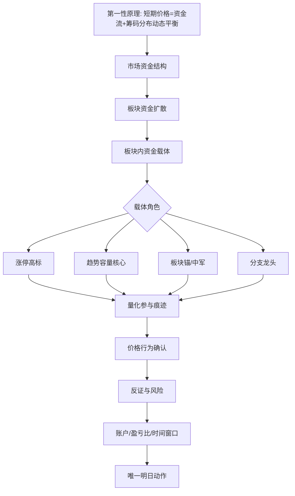

# Design: 板块资金扩散选股生成前审计

## Scope And Boundaries

This task records a generation-before-decision contract. It does not rewrite the
selection engine in this slice.

The contract must preserve four boundaries:

- First principle: short-term price comes from capital flow and chip
  distribution reaching a temporary balance.
- Sector first: the report looks for sector capital diffusion before selecting
  a stock.
- Capital carrier: the target is the stock repeatedly bought inside the sector;
  it may be a limit-up high marker, but it may also be a capacity trend core,
  sector anchor, center, or branch leader.
- Final action: only the existing final resolution layer may create the current
  action.

## Contracts / Data Flow

Generation-before-review flow:

The final report implementation can later render this as a pre-generation audit
block. For this slice, the Mermaid belongs in the backend spec as the source
contract.

## Compatibility / Migration

- Existing `selection_workflow.v1` and `elimination_tournament.v1` payloads stay
  compatible.
- Existing limit-up, hot-list, turnover, and score-like legacy fields may remain.
  The new contract only defines their role as evidence, not as automatic action.
- Existing replay reports are not regenerated in this slice.

## Tradeoffs

This task intentionally writes the contract before code changes. That keeps the
selection engine stable while making future implementation review strict: any
new runtime change can be checked against the Mermaid and the Spec.

The tradeoff is that the next generated report will not automatically show a new
pre-generation Mermaid block until a follow-up implementation wires it into the
generation path.

## Rollback / Roll-forward

Rollback:

- Revert the Spec/Wiki commit. No runtime data migration is required.

Roll-forward:

- Add a report-generation preflight renderer that emits the Mermaid audit block
  from existing `selection_workflow` and `elimination_tournament` payloads.
- Add acceptance checks that require the pre-generation flow to be present before
  official report artifacts are saved.
