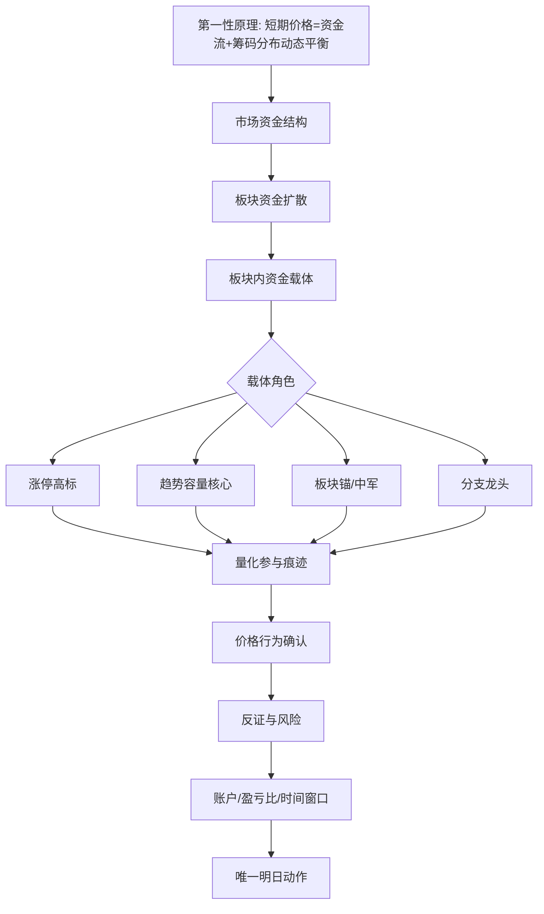

# Design: 日报生成前板块资金扩散审计落地

## Scope And Boundaries

This task adds a generation-before-decision artifact to the daily-report flow.
It does not replace the existing selection workflow or final target resolution.

The new artifact must stay observational:

- it describes the market/sector/carrier/price-action chain,
- it can show elimination and survivor counts,
- it may render Mermaid,
- it may be saved as companion HTML,
- but it must not generate a second execution target.

## Contracts / Data Flow

Recommended data path:

1. `scripts/report/runtime.py` builds the existing report runtime context.
2. A new structured `sector_capital_preflight` payload is built from existing
   runtime sources: `selection_workflow`, `final_target_resolution`,
   `two_layer_decision_payload`, `sniper_target_derivation`, and
   `elimination_tournament_payload`.
3. The payload is stored back into `data`,
   `execution_stage_context`, and `market_research_snapshot` just like the other
   runtime artifacts.
4. `scripts/report/two_layer_decision_payload.py` or the new payload renderer
   renders the Mermaid审计块 and compact audit lines.
5. `scripts/daily_report_entry_demo.py` saves the companion HTML beside the
   saved Markdown report.
6. `scripts/report/report_acceptance_audit.py` recognizes the companion HTML and
   verifies it against the report's final object and zero-position constraints.

Suggested payload shape:

```python
{
    "schema_version": "sector_capital_preflight.v1",
    "trade_date": "YYYY-MM-DD",
    "source": {
        "selection_workflow": {...},
        "final_target_resolution": {...},
        "two_layer_decision_payload": {...},
        "sniper_target_derivation": {...},
        "elimination_tournament_payload": {...},
    },
    "mermaid": "flowchart TD ...",
    "layers": [
        {
            "id": "market_capital_structure",
            "title": "市场资金结构",
            "input_count": 0,
            "eliminated_count": 0,
            "survivor_count": 0,
            "entries": [
                {
                    "name": "str",
                    "code": "str",
                    "status": "survived | eliminated | process_only | sector_reference",
                    "reason": "str",
                    "next_basis": "str",
                }
            ],
        }
    ],
    "final_action": {
        "label": "0%不参与 | 50%条件执行 | 100%核心进攻",
        "position_pct": 0 | 50 | 100,
        "target": {"code": "str", "name": "str"} | {},
        "source": "final_target_resolution | selection_workflow.final | str",
    },
}
```

The Mermaid block can be reused from the spec contract:



## Compatibility / Migration

- Existing report outputs remain valid.
- Companion artifact generation is additive.
- If preflight data is incomplete, the renderer should show missing fields instead
  of inventing a complete chain.
- Replay should write to `reports/replay/`; official should follow the normal
  report output path.
- The companion HTML should be named stably from the report date and context.

## Tradeoffs

Using existing runtime sources is the safest way to avoid divergent truth.
The tradeoff is that the first version may be conservative on older dates and
show more missing evidence. That is acceptable because honesty is more valuable
than forced completeness.

The artifact should stay dense and audit-oriented. It must help the user see
why one target survived, not turn into a second narrative report.

## Rollback / Roll-forward

Rollback:

- Disable the runtime store/save hook for the new payload.
- Keep Markdown report generation, selection workflow, and elimination renderer
  intact.

Roll-forward:

- Add finer layer attribution later once the runtime sources are richer.
- Add more audit comparisons only after the first companion path is stable.
