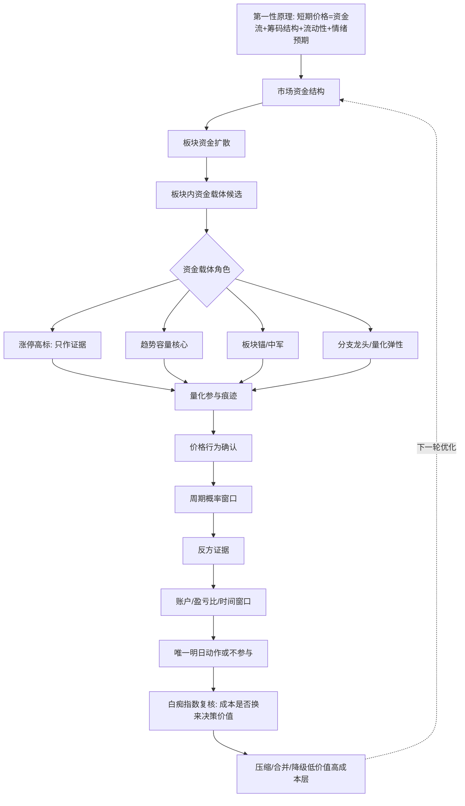

# Goal: 板块先行的量化跟随淘汰赛

## Outcome

日报选股主链路必须从市场资金结构和板块资金扩散出发，像量化一样先识别资金正在拥抱的板块，再在板块内部等待市场自己筛出资金载体。

旧的“先从涨停池里找分数最高的股票”要被淘汰。涨停、连板、热榜、龙虎榜、成交额异动和旧分数字段只能作为资金参与证据，不能作为日报选股起点，也不能单独生成明日标的。

最终产物必须同时给出：

- 一张 Mermaid 淘汰赛流程图。
- 一份逐层淘汰赛列表：本层有哪些股票或板块、淘汰哪些、为什么淘汰、剩下哪些。
- 一份相关决策列表：每个关键结论来自哪一层事实，反方证据是什么，下一次什么条件能恢复。
- 一个唯一明日动作或不参与结论。

## First Principle

短期价格由资金流、筹码结构、流动性和情绪预期动态平衡决定。

量化时代的人类优势不是比算法更快，而是观察算法和散户共同留下的可见行为：板块成交占比是否扩张，板块宽度是否扩散，核心是否横住，回撤是否有人接，后排是否反馈，关键线是否失守，尾盘是否抢回。

日报要做的是跟随这些可见行为，不是猜哪只股票会成为龙头。真正的标的是市场选出来的，量化资金会自己筛出来；日报只负责把板块路径、资金载体和淘汰理由讲清楚。

## Idiot Index Translation

Musk 的 `Idiot Index` 更准确的口径是：部件或成品总成本 ÷ 原材料成本。比例越高，越说明设计、制造、供应链或中间流程里可能藏着低效环节。10:1 常被当作优先排查的候选，不是任何领域都机械套用的绝对线。

对本项目要分清两个比例：

- `Musk 原始例子`：偏向 10:1。比如一个部件成本 1000 美元，原材料只有 100 美元，说明中间设计、制造、供应链或外包流程里可能有巨大低效。
- `日报项目生存线`：使用者投入的 token、时间、数据成本和复杂度，必须在复盘周期里大致换来至少 5 倍以上的真实收益、避损或错误减少价值。这里不是精确计算公式，而是项目经营常识线。达不到这条线，说明日报项目本身可能已经过度复杂，需要压缩流程。

日报里的对应关系不是“原材料成本 vs 成品售价”，而是两条复盘问题：

```text
这层消耗了多少决策成本？
它有没有带来足够多的决策价值？
```

其中：

- `决策成本`：token、数据请求、等待时间、版面长度、维护复杂度、读者理解成本，以及维护这个系统的机会成本。
- `决策价值`：实际捕捉到的收益、明确避免的亏损、减少的冲动交易、是否改变唯一明日动作、是否解释某个淘汰理由、是否识别被资金选择的板块、是否暴露关键反方证据。

如果某一层消耗很大，却不能回答“板块是否被资金选择、谁是资金载体、为什么淘汰、明日怎么做”，它就是日报里的高白痴指数环节。下一轮优化要优先压缩、合并、降级或删除这类环节。

白痴指数不用于产生明日标的，只用于优化日报流程。它的作用是逼迫系统回到第一性原理：用最少的必要证据，解释最大比例的真实决策。

项目复盘口径只做分类，不做伪精确计算：

- `明显超过项目生存线`：项目复杂度暂时合理，继续优化关键层。
- `有价值但没有超过项目生存线`：项目有价值但不够高效，必须压缩高成本低价值环节。
- `低于投入成本`：项目当前是负收益系统，应停止扩展功能，只做减法。
- `无法复盘收益或避损`：说明日报没有形成可复盘账本，也视为高风险状态。

## Probability Window And Risk Reward

交易判断不能把项目生存线误写成选股公式。选股仍回到 Al Brooks 的交易者等式：成功可能、目标空间、失败损失和仓位伤害。

默认情况下，买一只股票先按没有优势理解：上涨和下跌都可能发生。日报的任务不是凭空算出一个数字，而是识别什么时候市场进入短暂的概率窗口。

A 股里的“周期”就是这种概率窗口：

- 市场资金结构允许进攻。
- 板块资金正在扩散。
- 板块内资金载体被反复参与。
- 价格行为接受资金表态。
- 反方证据没有压倒正向证据。
- 认错线和目标空间形成合理盈亏比。

概率窗口不是新增模块，也不是另一个指标。它是淘汰赛末端对市场、板块、资金载体、价格接受、反方证据和账户边界的合并判断；它只能收口成“可做、只观察、不参与”，不能重新发散成多个明日标的。

只有这些条件共同出现时，机会才从默认无优势进入可做比较。即使如此，也不能写成 `成功率 68%`、`胜率 72%`、`期望值 1.6` 这类伪精确；只能写成“概率窗口打开/未打开”“盈亏比合适/不合适”“周期仍在/周期破坏”。

日报最终要回答的不是“模型算出来有多大胜率”，而是：

| 问题 | 合格表达 |
|---|---|
| 当前是否有概率窗口 | 周期窗口打开 / 未打开 / 待确认 |
| 为什么概率短暂倾斜 | 板块扩散、资金载体承接、价格接受、后排反馈 |
| 上错了怎么办 | 失效线、时间窗口、账户伤害、退出动作 |
| 值不值得下注 | 盈亏比合适才参与；盈亏比不合适只观察 |

## Required T+1/T+2 Rehearsal

日报不能只说 T+1 买哪个，还必须在 T0 复盘时预演 T+1 和 T+2 的交易环境。

T0 的职责：

- 判断市场和板块是否有 T+1 参与资格。
- 给出 T+1 的允许买入窗口、确认条件和取消条件。
- 预演 T+2 的市场情绪、板块情绪和卖出处理：冰点、震荡、高潮、分歧、延续或退潮。
- 明确 T+1 如果快速冲到接近涨停、T 字强势上板、封单过强、没有回踩承接，就算方向判断对，也可能买不到或不值得追。

T+1 的职责：

- 只复核 T0 的预案是否发生，不回写 T0 选股依据。
- 判断买点是否真实可达：开盘前几分钟是否已经接近涨停、是否 T 字强势上板、是否给过回踩或承接窗口。
- 如果买不到，要记录为“方向对但买点不可达”，不能把 T+2 收益当作真实可执行收益。

T+2 的职责：

- 只做卖出窗口和预案校准。
- 分别复核 T+2 开盘、日内中枢、尾盘三个窗口的结果。
- 统计收益时必须区分：纸面收益、可执行收益、方向命中但无法买入。

## Required Reasoning Revision Ledger

每天可以多次复盘矫正。每次矫正不能覆盖前一次推理，应保存为类似 git diff 的结构，减少 token 并保留思考路径。

每次推理记录至少包含：

| 字段 | 含义 |
|---|---|
| `revision_id` | 当天第几次复盘或生成 |
| `created_at` | 复盘时间 |
| `base_revision_id` | 基于哪一次推理修改 |
| `changed_decisions` | 哪些判断变了 |
| `changed_reasons` | 为什么变 |
| `added_evidence` | 新增了哪些事实 |
| `removed_evidence` | 哪些旧证据被否定或降级 |
| `action_change` | 明日动作是否变化 |
| `diff_summary` | 人能读懂的最小差异摘要 |

保存规则：

- 第一次复盘保存完整推理。
- 后续复盘只保存差异，必要时引用前一次推理。
- 差异必须能回答：板块判断是否变、资金载体是否变、买点是否变、空仓理由是否变、T+1/T+2 预案是否变。
- 若只是补充事实但不改变动作，也要记录为“事实补充，动作不变”。
- 不能为了节省 token 丢掉导致动作变化的原因链。

## Required Replay Price Path And Buyability Review

前向回测不能只看最终收益，还要看这个机会在真实交易中是否买得到。

对于 T0 选出的纸面主样本，回测必须展示：

| 日期角色 | 必须展示 |
|---|---|
| T0 决策日 | 当天涨跌幅、是否接近涨停/跌停、是否已经处在高风险追涨状态 |
| T+1 买入日 | 当天涨跌幅、是否接近涨停/跌停、是否开盘前几分钟快速接近涨停、是否真实可买 |
| T+2 卖出日 | 当天涨跌幅、是否接近涨停/跌停、三个卖出窗口的纸面结果 |

买点可达性必须单独分层：

- `理论可观察`：T+1 没有在开盘前几分钟直接逼近涨停，仍可能存在观察或回踩窗口。
- `追高风险`：T+1 开盘或前几分钟快速上冲，买到的位置可能已经偏高。
- `可能买不到`：T+1 前几分钟已经接近涨停、T 字强势上板或封死，纸面收益不能直接算作可执行收益。
- `分时事实待补`：没有分钟事实时必须明说待补，不能用日线替代分时路径。

统计口径：

- `纸面收益`：按日线代理窗口计算，只能说明方向和窗口。
- `可执行收益`：必须有分时买点可达性支持；没有分时事实时不得宣称可执行。
- `方向命中但不可买`：保留为策略缺陷样本，用来优化 T+1 买点规则。

## Required Mermaid

日报和 companion HTML 至少要表达这条流程：



## Required Tournament List

每次日报生成时，淘汰赛证据必须按层展示，不能只写“淘汰了”。

模板：

| 层级 | 本层输入 | 本层淘汰 | 淘汰理由 | 本层剩余 | 下一层依据 |
|---|---:|---|---|---|---|
| 市场资金结构 | N个板块/方向 | A、B | 市场不支持进攻、成交不足、风险偏好下降 | C、D | 是否有资金集中选择 |
| 板块资金扩散 | N个板块 | A | 只有单点异动，后排无承接 | B | 板块成交占比、宽度、核心承接 |
| 板块内资金载体 | N只股票 | A、B | 只是后排补涨，无法证明资金反复回看 | C、D | 角色：趋势容量核心、板块锚、量化弹性 |
| 量化参与痕迹 | N只股票 | A | 只是一日脉冲，没有重心抬高和回踩承接 | B | 放量不崩、缩量不死、回撤有人接 |
| 价格行为确认 | N只股票 | A | 炸板、尾盘回封、高换手、跌回关键线 | B | 明日可验证窗口 |
| 周期概率窗口 | N只股票 | A | 周期未打开或已经破坏，默认回到无优势状态 | B | 周期仍在、概率短暂倾斜 |
| 账户/盈亏比/时间窗口 | N只股票 | A | 失效线太远、账户不适配、窗口不清 | B或空 | 唯一动作 |

每个股票行必须有：

- `stock_code`
- `stock_name`
- `sector`
- `status`: `survived | eliminated | process_only | final_action | sector_reference`
- `reason`
- `elimination_basis`
- `next_basis`

## Required Decision List

companion HTML 和审计载体必须给出决策列表：

| 决策项 | 当前结论 | 事实依据 | 反方证据 | 明日验证 | 动作 |
|---|---|---|---|---|---|
| 市场能否进攻 | 可进攻/不进攻/只观察 | 成交、赚钱效应、风险偏好 | 放量下跌、上涨家数弱、跌停扩散 | 次日开盘和主线反馈 | 空仓/标准仓/核心仓 |
| 哪个板块被选择 | 板块名或空 | 成交占比、板块宽度、核心承接 | 后排掉队、竞争方向更强 | 是否继续扩散 | 进入或淘汰 |
| 谁是资金载体 | 股票名或空 | 趋势容量、板块锚、量化弹性、分支龙头 | 只是涨停样本、补涨后排 | 是否回撤有人接 | 进入或淘汰 |
| 是否有量化参与痕迹 | 有/不足 | 重心抬高、放量不崩、缩量不死、回踩承接 | 一日冲高、尾盘抢筹失败 | 是否继续被买回 | 进入或淘汰 |
| 价格行为是否接受 | 接受/不接受 | 收盘位置、回封质量、VWAP/均线关系 | 炸板、高换手、跌回关键线 | 指定窗口确认 | 参与或观察 |
| 周期概率窗口是否打开 | 打开/未打开/待确认 | 市场、板块、资金载体和价格行为同向 | 周期破坏、后排掉队、价格不接受 | 是否延续同一资金路径 | 参与或观察 |
| 账户是否适配 | 适配/不适配 | 一手金额、失效价、单笔亏损边界 | 失效线太远、T+1风险大 | 买点靠近认错线 | 执行或放弃 |

## Required Idiot Index Review List

companion HTML 或任务复核中必须能看到低效环节排查表。这个表不追求精确数值，只做高/中/低的优化优先级判断。

| 环节 | 成本代理 | 决策价值 | 白痴指数信号 | 处理动作 |
|---|---|---|---|---|
| 涨停池起点 | 数据多、噪音高、容易多标的 | 不能解释板块为什么被资金选择 | 高 | 降为证据层，不作起点 |
| 多模块各自选股 | token 高、冲突多、读者难复核 | 容易生成多个明日标的 | 高 | 合并到统一淘汰赛链路 |
| 主观分数排序 | 看似精确、维护成本高 | 不能说明真实淘汰理由 | 高 | 替换为条件链和事实理由 |
| 长篇正文堆叠 | token 高、阅读成本高 | 不能改变动作或淘汰理由 | 高 | 折叠、压缩或移到附录 |
| 板块资金扩散 | 成本中等 | 决定是否有主攻方向 | 低 | 保留为主链路 |
| 资金载体角色 | 成本中等 | 决定股票是否进入下一层 | 低 | 保留为主链路 |
| 价格行为和反方证据 | 成本中等 | 决定参与或不参与 | 低 | 保留为主链路 |
| 项目生存线复盘 | 成本低 | 判断项目是否值得继续复杂化 | 低 | 每个复盘周期保留 |

处理规则：

- 高成本、低决策价值：压缩、合并、降级到附录，或删除。
- 高成本、高决策价值：保留，但必须折叠、结构化和可审计。
- 低成本、高决策价值：保留在主链路。
- 低成本、低决策价值：只在附录保留，不能影响最终动作。

## Daily K-line Process Calibration Through 2026-06-12

中船特气和信维通信只作为范式校准样本，不是当前自动买入对象。

校准样本必须研究逐日 K 线过程，不能只看一个截止日期截面，也不能只拿早期上涨段证明当前仍可做。研究对象是：

- 上升从哪里开始。
- 哪些交易日推动重心抬高。
- 回踩时是否仍有承接。
- 是否通过连续价格接受而不是每天涨停来完成上涨。
- 后续哪一天开始出现价格接受转弱。
- 到 2026-06-12 时，它仍是范式样本还是当前可做对象。

本轮用 `.generated/venv-py314/bin/python3.14` 调用 `fetch_daily_price_bars(..., prefer_fast=True, allow_baostock_fallback=True)` 补齐逐日 K 线；实际可用来源为 QuickTiny merged kline。Tushare 区间日线本轮被远端断开，未作为事实来源。完整日线表和研究记录见 `research/calibration-kline-process-20260612.md`。

逐日过程事实：

- `中船特气(688146)`：2026-04-03 到 2026-06-12 共 47 个交易日，收盘价从 51.22 到 302.00；最高收盘为 2026-06-11 的 349.80。从起点到最高收盘约 +582.94%，到 2026-06-12 仍约 +489.61%，但 2026-06-12 相对前一日最高收盘回落约 -13.66%。除首日外，上涨 35 天、下跌 10 天、平盘 1 天；接近 20cm 的交易日为 5 天。
- `信维通信(300136)`：2026-03-25 到 2026-06-12 共 54 个交易日，收盘价从 62.42 到 96.86；最高收盘为 2026-05-22 的 118.98。从起点到最高收盘约 +90.61%，到 2026-06-12 仍约 +55.17%，但从最高收盘到 2026-06-12 回落约 -18.59%。除首日外，上涨 28 天、下跌 25 天；接近 20cm 的交易日为 0 天。

这两个样本说明：

- 好股不一定每天涨停。
- 资金载体的核心特征是逐日被市场反复接受，而不是单日封板形式。
- 逐日 K 线可以证明价格行为：不断抬高重心、回踩承接、放量换手后是否继续上移、缩量或分歧后是否仍能修复；但它不能单独证明具体是哪类资金在买。
- 量化跟随只是范式假设：日报要用板块扩散、成交核心、价格接受、回踩承接和反方证据来靠近这种行为，而不是写成“已证明量化买入”。
- 一旦后续逐日过程进入价格接受转弱，就必须按当前价格行为和反方证据重新处理，不能静态追认早期上涨。
- 从涨停池起步会漏掉趋势容量核心、板块锚和量化弹性载体。
- 旧的打板高标法只能作为一种市场风格证据，不能作为当前日报默认选股主线。
- 范式样本不能静态崇拜：上涨过程只保护“如何从板块找资金载体”的方法，不追认 2026-06-12 的买入资格。

后续若要更新样本，必须重新拉取逐日 K 线并记录来源；没有逐日序列时，只能写“样本过程缺失”，不能用单日截面替代过程研究。

## In Scope

- 把 `sector_capital_preflight.v1` 目标定义为板块先行、量化跟随、资金载体筛选的生成前复核。
- companion HTML 必须展示 Mermaid、逐层淘汰赛列表和相关决策列表。
- companion HTML 或任务复核必须展示白痴指数复核表，用来识别高成本低价值环节。
- 淘汰赛每层都必须列出输入数量、淘汰对象、淘汰理由、剩余对象和下一层依据。
- 过程候选可以保留为证据，但最终只能有一个明日动作或不参与结论。
- 旧涨停池、分数、热榜、连板、龙虎榜只能作为证据字段进入对应层，不能直接决定最终对象。
- 保留现有验收检查：Markdown 正文、companion HTML、运行期结构化证据最终动作必须一致。

## Out Of Scope

- 不在这个 goal 文件里直接重写全部选股代码。
- 不把中船特气、信维通信写成当前固定买入对象。
- 不新增实时数据源。
- 不把 companion HTML 做成交互式前端。
- 不用当前行情冒充历史事实。
- 不把过程候选包装成新的明日标的。

## Non-goals

- 不追求伪精确分数。
- 不把白痴指数写成新的精确分数或选股指标。
- 不把项目生存线写成选股公式；它只判断项目复杂度是否值得继续保留。
- 不承诺“花了 token 就一定赚钱”；项目生存线只能用复盘后的真实收益、避损和减少误买来判断。
- 不写伪精确胜率；默认按无优势处理，只有周期窗口、价格接受和盈亏比让机会进入可做比较。
- 不用不可验证的量化痕迹做确定性结论。
- 不用“没有风险”代替“条件满足”。
- 不让涨停池、情绪模块、技术模块分别输出多个明日标的。
- 不把观察对象写成买入资格。
- 不把样本经验变成固定公式。

## Constraints

- 所有 Python 命令必须使用 `.generated/venv-py314/bin/python3.14`。
- 用户可见文字必须使用交易语言，避免工程实现词污染日报表达。
- 复核证据只能复用已有日报上下文和已落盘 payload，不额外触发实时全量采集。
- 任何 0% 不参与场景，都不能在 companion HTML 中泄漏新的执行对象。
- 若历史官方快照缺失，必须明确停止 fresh replay，并说明缺口，不能用当前数据冒充历史事实。
- 数字只能说明发生了什么；参与资格必须来自条件链、反方证据和账户边界。
- 白痴指数只用于优化流程效率，不用于决定买入资格。
- 项目复盘达不到生存线回报感时，下一轮默认做减法：压缩正文、合并模块、删除不能影响动作的展示层。
- 个股参与资格必须经过概率窗口和盈亏比检查；周期未打开或盈亏比不合适时，不因为板块热、涨停或主观看好参与。

## Done Definition

- `sector_capital_preflight.v1` 能表达板块先行的淘汰赛链路，而不是旧涨停池起点。
- companion HTML 能同时展示 Mermaid、逐层淘汰赛列表和相关决策列表。
- companion HTML 或任务复核能指出高成本低价值环节，并给出压缩、合并、降级或保留动作。
- 任务复核能按项目生存线判断：本轮复杂度是否值得继续保留；若无法复盘，要说明缺少哪些字段。
- 淘汰赛能展示周期概率窗口是否打开，以及盈亏比是否支持参与。
- 每层输入、淘汰、剩余和理由内部一致；没有理由的淘汰必须被视为不合格。
- 非涨停趋势容量核心、板块锚或量化弹性样本，在板块扩散和价格接受存在时，不能因为不在涨停池而被提前排除。
- 涨停池高分样本，如果不能证明板块角色、资金反复参与和价格接受，只能作为过程证据。
- 最终动作在 Markdown 正文、companion HTML 和运行期结构化证据中一致。
- focused tests 通过。
- `git diff --check` 通过。
- 如果 fresh replay 因官方快照缺失无法运行，必须在任务文档和最终说明中如实记录，不能把它标为完成。

## Verification Evidence

已通过：

```bash
.generated/venv-py314/bin/python3.14 -m py_compile scripts/report/elimination_tournament.py scripts/report/runtime.py scripts/report/report_acceptance_audit.py scripts/daily_report_entry_demo.py tests/test_elimination_tournament.py tests/test_report_runtime.py tests/test_report_acceptance_audit.py tests/test_daily_report_entry_html_output.py
```

```bash
.generated/venv-py314/bin/python3.14 -m unittest tests.test_report_runtime tests.test_elimination_tournament tests.test_report_acceptance_audit tests.test_daily_report_entry_html_output
```

结果：`Ran 410 tests ... OK`

```bash
.generated/venv-py314/bin/python3.14 -m unittest tests.test_two_layer_decision_payload tests.test_daily_report_entry_html_output tests.test_report_acceptance_audit
```

```bash
.generated/venv-py314/bin/python3.14 -m unittest tests.test_sector_capital_carrier_strategy tests.test_sector_forward_replay tests.test_tushare_minute_service tests.test_tushare_input_runtime tests.test_tushare_turnover_service tests.test_market_state_request tests.test_tushare_client
```

结果：`Ran 144 tests ... OK`

补充覆盖：`DailyPriceRefill` 批量日线回补必须核对返回行 `date/trade_date` 与请求交易日一致；请求 `2026-06-09` 但返回 `2026-06-16` 时记为缺失和错日样本，不进入历史回放价格事实。

```bash
.generated/venv-py314/bin/python3.14 -m unittest tests.test_elimination_tournament tests.test_report_runtime tests.test_report_acceptance_audit tests.test_daily_report_entry_html_output tests.test_daily_report_entry_preflight tests.test_daily_report_render
```

结果：`Ran 554 tests ... OK`

```bash
.generated/venv-py314/bin/python3.14 -m unittest tests.test_decision_ledger tests.test_decision_statistics tests.test_daily_report_markdown_html tests.test_market_overview_builder tests.test_market_structure_judgement tests.test_execution_chain_overview_nodes tests.test_postgres_daily_fact_db tests.test_pk_decision_renderer tests.test_front_page_v2_renderer tests.test_daily_report_skill_docs
```

结果：`Ran 332 tests ... OK`

```bash
git diff --check
```

已确认通过。

提交前审计额外复核：

```bash
.generated/venv-py314/bin/python3.14 scripts/report/report_acceptance_audit.py reports/replay/2026-06-12_A股日报_完整版_replay.md --companion-html reports/replay/2026-06-12_板块资金扩散生成前复核.html
```

结果：当前本地 replay 产物未通过；发现 4 条 `positive_final_action_appendix_conflict`。前台已经给出 `长电科技(600584)` 与 `50%条件执行`，但附录仍保留旧的不参与口径。该 replay 产物位于 `.gitignore` 排除的 `reports/` 目录，不作为本轮代码提交证据。

## Blocked Condition

fresh replay 尚未完成，因为当前工作区缺少：

```text
snapshots/2026-06-12.json
```

已运行但停止：

```bash
.generated/venv-py314/bin/python3.14 scripts/daily_report_entry_demo.py 2026-06-12 --replay
```

停止原因：

```text
快照不存在: 2026-06-12，无法复盘
```

在官方快照补齐前，不能完成 fresh replay 重新生成；当前已有本地 replay 产物也不能作为通过证据。下一次补齐 `snapshots/2026-06-12.json` 后，必须重新生成 replay Markdown 与 companion HTML，再运行一致性检查。

## Iteration Policy

- 下一轮优化优先检查：日报是否仍有从涨停池、分数或多个模块独立标的出发的旧路径。
- 同时检查每个环节的日报白痴指数：成本是否明显高于它对唯一明日动作、淘汰理由和板块路径解释的贡献。
- 每个复盘周期检查项目是否达到生存线回报感；没有达到时，不新增功能，先做减法。
- 只有当层级证据、最终动作一致性、HTML 可读性或验收检查暴露问题时，才继续优化展示和逻辑。
- 每次优化都必须能对应到一个可见失败或明确验收缺口。
- 展示优化可以改折叠、滚动、密度和可读性；不得借展示优化改变最终动作。
- 逻辑优化必须先说明该层为什么保留或淘汰，避免用分数制造精确幻觉。
- 交易优化必须先判断周期概率窗口和盈亏比，不用精确胜率包装主观看好。
- 如果某个模块连续不能改变动作、不能解释淘汰、不能降低误买风险，就必须降级为附录或删除。
- 若要改变选股规则，应另开任务，把板块资金扩散、量化参与痕迹、价格行为和账户边界写成可测试条件。

## Global Forward Replay Goal From 2026-04

用户指出：短线日报不可能从四月开始每天最终都是 `0%不参与`。如果全局前向回测显示长期没有任何可参与对象，优先判断为策略链路、数据回放链路或最终动作转换链路存在问题，不能把它解释成“市场每天都没有机会”。

本轮新增一个全局回测目标：

- 从 2026-04-01 起读取本地可用历史日报事实。
- 按交易日生成 `D -> 下一可用交易日` 的日期对。
- 只用 T0 日事实生成候选、淘汰链和最终动作。
- 只用 T+1 日事实复核 T0 候选买入日表现。
- 只用 T+2 日事实复核卖出窗口代理收益。
- 不用 T+1 或 T+2 日事实反向生成 T0 候选。
- 不用当前行情补历史。
- 不把回测结果硬调成有标的。

回测必须回答四个问题：

| 问题 | 合格输出 |
|---|---|
| 是否真的每天都是 0% | 给出全样本最终动作分布，列出 0%、50%、100% 日期 |
| 如果长期 0%，卡在哪里 | 给出逐日最后有候选的层、首次归零层、最终不参与理由 |
| 是否是数据缺口导致 | 给出每个日期的事实覆盖、是否回退到上一可用交易日、缺失字段 |
| 是否是策略条件过严 | 给出候选数量、最终动作、T+1 表现和 T+2 卖出窗口之间的错配样本 |

诊断必须按交易语言表达：

- `候选入口为空`：T0 没有可用候选或历史事实未覆盖候选源。
- `板块扩散未通过`：有线索，但不能证明板块被资金选择。
- `资金载体未通过`：板块存在，但个股只是后排、旧信号或无法证明反复参与。
- `价格行为未通过`：候选存在，但价格接受、回踩承接、回封质量或关键线不满足。
- `周期/账户条件未通过`：价格行为尚可，但周期窗口、盈亏比、认错线或时间窗口不支持参与。
- `最终动作转换异常`：前面仍有合格候选，但最终动作仍长期 0%，且没有具体不参与理由。

特别关注异常样本：

- T0 最终 0%，但 T+1 同板块或同候选明显走强。
- T0 候选在价格行为层仍存活，但最终动作没有给出具体不参与理由。
- T0 候选入口来自涨停池或热榜，未被转译成板块资金扩散和资金载体证据。
- T0 板块已经被市场选择，但趋势容量核心、板块锚或二波预期样本被提前排除。

全局回测 HTML 必须新增汇总诊断：

| 汇总项 | 要求 |
|---|---|
| 样本区间 | 起始日期、结束日期、有效日期对数量 |
| 最终动作分布 | 0%、50%、100% 各有几天，列出日期 |
| 候选数量分布 | 每天候选数、候选长期为 0 的日期 |
| 首次归零层分布 | 哪一层最常把候选压没 |
| 异常错配样本 | T0 不参与但 T+1 证据明显走强的样本，并补 T+2 卖出窗口 |
| 下一步修正方向 | 数据缺口、条件过严、转换异常、展示问题四类归因 |

Done Definition 补充：

- 可以一条命令生成从 2026-04-01 起的 T0 -> T+1 -> T+2 全局前向回测 HTML。
- HTML 不只展示逐日列表，还必须展示全局汇总和 0% 归因。
- 若长期全是 0%，必须在 HTML 和最终说明中明确归因方向，不能只说“观察”。
- 若数据覆盖不足，必须列出缺口日期；不能把数据缺口解释成策略判断。
- focused tests 覆盖自动日期对、最终动作分布、首次归零层和异常错配样本。

## Global Forward Replay Evidence 2026-04-01 To 2026-06-12

已生成：

```bash
.generated/venv-py314/bin/python3.14 scripts/replay/sector_forward_replay.py --start-date 2026-04-01 --end-date 2026-06-12 --output reports/replay/2026-04-01_2026-06-12_板块资金扩散前向回测.html
```

输出：

```text
reports/replay/2026-04-01_2026-06-12_板块资金扩散前向回测.html
```

读回内嵌 JSON 的结果：

| 项目 | 结果 |
|---|---|
| 可用日期 | 49 天 |
| T0 -> T+1 -> T+2 样本 | 48 组；最后一组 T+2 卖出日由 TuShare 交易日历补到 2026-06-15 |
| 样本区间 | 2026-04-01 到 2026-06-15 |
| 旧链路最终动作分布 | `0%`: 48 天 |
| 旧链路非 0% 日期 | 无 |
| 旧链路候选数范围 | 0 到 47 |
| 旧链路候选入口为空 | 36 天 |
| 旧链路异常错配样本 | 8 组 |
| 新版纸面动作分布 | `纸面参与`: 39 天；`纸面观察`: 1 天；`纸面不参与`: 8 天 |
| 新版纸面候选数范围 | 0 到 8 |
| 新版纸面候选为空 | 8 天 |
| 新版纸面主样本 T+1 买入复核 | `纸面个股命中`: 5 天；`板块命中但个股未到执行级别`: 15 天；`只延续热度观察`: 3 天；`纸面未通过复核`: 17 天；`没有纸面主样本`: 8 天 |
| T+1真实可买性复核 | `分时事实待补`: 40 天；理论可观察、追高风险、可能买不到均为 0 天，原因是当前 TuShare 分时接口/权限未打通 |
| T+1买入 x T+2卖出窗口统计 | 当前 39 个可计算纸面主样本中，T+1 `09:30-09:35` 买入代理 + T+2 `14:30-14:55` 卖出代理平均代理收益约 +1.50%，为当前较优组合 |
| T+2卖出窗口统计 | 09:30-09:35：39 个可计算样本，平均代理收益约 -0.08%，正收益 15 次；09:50-10:10：39 个可计算样本，平均代理收益约 +0.71%，正收益 26 次；14:30-14:55：39 个可计算样本，平均代理收益约 +1.26%，正收益 22 次 |
| 当前窗口建议 | 当前样本里 T+1 `09:30-09:35` 买入代理、T+2 `14:30-14:55` 卖出代理的平均收益较优；但没有分时买点事实，不能宣称真实可执行 |
| T0 推演 T+2 市场批改 | T0 推演 T+2 为震荡：40 组；可评分 34 组，正确 34 组，偏离 0 组，待校准 6 组；对应窗口当前较优为 14:30-14:55，平均代理收益约 +1.26% |
| T0 推演 T+2 板块批改 | T0 推演 T+2 为分歧：40 组；可评分 33 组，正确 0 组，偏离 33 组，待校准 7 组；T+2 实际延续 8 组、扩散 25 组；偏离样本仍提示板块预案偏保守 |
| 新版纸面命中/板块确认样本 | 20 组 |
| TuShare价格事实 | 默认优先请求 T0/T+1/T+2 日线；本轮请求 48 个交易日、尝试 1090 只次，取到 1039、缺 51、错 0 |
| TuShare分时事实 | 默认优先请求 T+1 5分钟分时；`stock_mins` 返回“请指定正确的接口名”，`stk_mins` 返回“请联系管理员添加此权限”；本轮尝试 440 只次，取到 0、缺 440、错 5，连续错误后停止继续请求 |
| TuShare T+2日期事实 | 默认优先请求交易日历；本轮请求 1 次，补到 2026-06-12 后的下一交易日 2026-06-15，缺 0、错 0 |

0% 归因分布：

| 归因 | 天数 |
|---|---:|
| 候选入口为空 | 36 |
| 价格行为未通过 | 7 |
| 板块扩散未通过 | 3 |
| 周期/账户条件未通过 | 2 |

首次归零层分布：

| 首次归零层 | 天数 |
|---|---:|
| 市场资金结构 | 39 |
| 价格行为确认 | 7 |
| 反方证据与账户/盈亏比/时间窗口 | 2 |

当前结论：

- 当前回测链路被全样本反证：48/48 天最终都是 `0%不参与`，100% 有问题，不能解释成“市场每天都没有机会”。
- 在修复前，不能把这份回测当作策略有效证据，只能把它当作故障定位证据。
- 四月到五月中旬大量 `候选入口为空`，主要是历史快照缺少后来新增的 `selection_workflow` / `candidate_trace` 等结构化候选事实；这属于回测事实入口不完整，不是市场判断。
- 五月下旬到六月，已经能形成候选，但多次在价格行为层或账户/周期层变成 0%，并出现 T0 不参与、T+1 同候选或同板块走强的错配样本。
- 本轮新增的 `sector_capital_carrier_paper_strategy.v1` 只用于回测校准：它从 T0 热板、资金表、板块涨幅、主线记录、热榜、成交额榜和涨停池证据恢复“板块资金载体”，T+1 只做买入日复核，T+2 只做卖出窗口复核，不回写 T0 候选。
- 本轮新增 `t0_tplus2_emotion_projection.v1`：T0 当晚先给 T+1/T+2 市场和板块交易环境预案，T+2 到来后用上帝视角批改正确/偏离/待校准，不回写 T0 选择。
- 新版纸面策略在 40/48 天恢复出板块资金载体，其中 39 天为纸面参与、1 天为纸面观察，说明“每天都没有标的”不是历史事实本身，而是旧候选恢复入口和最终动作转换链路的问题。
- 新版纸面策略不能直接替代正式日报动作。下一步应逐日检查 20 组纸面命中/板块确认样本，以及 17 组纸面未通过复核样本，把有效条件沉淀回正式日报链路。
- 当前 T0 市场情绪预案有校准价值，但板块预案明显偏保守；下一轮优化重点不是继续加精确分数，而是找出哪些 T0 板块分歧会在 T+2 变成延续或扩散。
- T+1/T+2 后验复核必须优先 TuShare。本轮代码已经默认开启 TuShare 日线、交易日历和分时；日线和交易日历可用，分时接口/权限不可用，HTML 必须显示请求次数、缺口和错误样本，不能静默退回本地事实。
- 当前分时事实缺失意味着“纸面收益”不能升级为“可执行收益”。下一步若要复核 9:35 前是否真实买得到，必须先打通 TuShare 分时接口权限，或接入同等可追溯的历史分钟事实源。

高优先级错配样本：

| T0 -> T+1 -> T+2 | T0 归因 | T+1 证据提示 |
|---|---|---|
| 2026-05-22 -> 2026-05-25 | 板块扩散未通过 | 风华高科、宏和科技、黄河旋风后验走强但流程未接住 |
| 2026-06-08 -> 2026-06-09 | 价格行为未通过 | 泰和新材价格延续；华电辽能后验走强但流程未接住 |
| 2026-06-11 -> 2026-06-12 | 周期/账户条件未通过 | 和远气体价格延续；江丰电子、云南锗业板块方向命中 |
