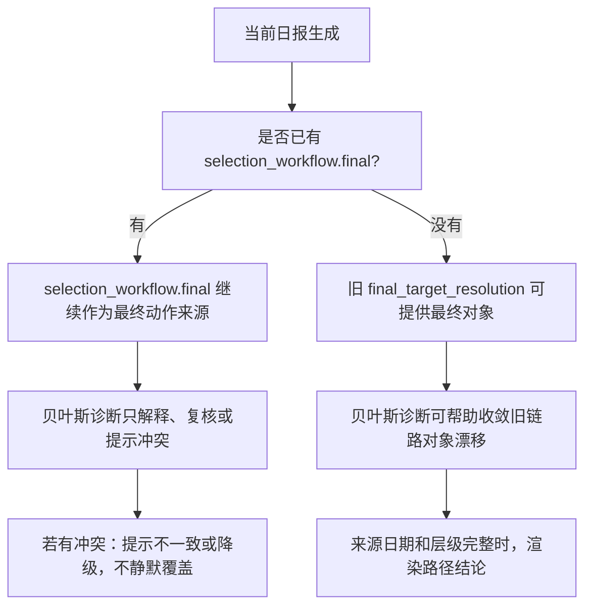

# 贝叶斯诊断迁移流程

## 目的

这份文档记录 `codex/bayesian-diagnosis-module` 和当前 `develop` 工作树之间的功能分歧、逻辑分歧和迁移建议。

在这些选择确认前，不应该直接迁移代码。

## 当前状态

- 当前主工作树已经包含“日报结构优化”和大量未提交的日报主链路改动。
- `cf52` 不是主要遗漏切片。当前主工作树基本是它的超集。
- `codex/bayesian-diagnosis-module` 是真实遗漏功能分支：
  - 有 15 个提交尚未进入 `develop`。
  - 还有 12 个文件存在未提交改动。
  - 该 worktree 的聚焦测试已通过：148 个测试 OK。
- 当前主工作树没有 `bayesian_diagnosis`、`path_conclusion` 或贝叶斯诊断展示入口。

## 决策流程



## 功能分歧

| 位置 | 当前主工作树 | Bayesian worktree | 问题 | 建议 |
|---|---|---|---|---|
| 最终动作来源 | `selection_workflow.final` 存在时，它是严格最终来源。 | 贝叶斯结论可以在 `sniper_target_derivation` 中覆盖旧最终对象。 | 直接覆盖可能破坏当前“板块先行、最终对象唯一”的主链路。 | 保留 `selection_workflow.final` 的最终来源地位。贝叶斯只在旧链路无最终来源时辅助收敛，或输出不一致提示。 |
| 用户可见结论 | 当前口径倾向直接交易语言。 | 最初计划使用 `diagnosis_label` 这类粗可信标签；后续未提交改动已改成 `path_conclusion`。 | 粗可信标签容易变成伪概率表达。 | 保留 `path_conclusion`，禁止用户可见输出使用 `diagnosis_label`。 |
| `market_analysis_builder.py` | 当前主树已把 `target_date` 传入市场分析。 | 已提交部分增加了 `target_date`，但未提交改动又删掉它。 | 如果拿 bayesian 的未提交版本，会回退当前主树能力。 | 不迁移 bayesian 的 `market_analysis_builder.py`，保留当前主树版本。 |
| 日报展示文字 | 当前主树已加强 `0%不参与`、`50%条件执行`、旧仓处理等口径。 | Bayesian 未提交改动也做了旧词清洗，但基于较旧展示结构。 | 整文件复制会覆盖日报结构优化。 | 只迁移必要 helper 和测试，不复制整个 renderer/runtime 文件。 |
| 接受检查 | 当前主树已有大量日报一致性检查。 | Bayesian 增加路径层级、来源日期、粗可信标签检查。 | 这些检查有价值，但可能和当前检查命名、章节边界重叠。 | 手工加入贝叶斯专项检查，不能削弱当前主树已有检查。 |

## 需要确认的逻辑分歧

### 1. 贝叶斯诊断到底是“决策者”还是“复核者”？

建议：

- 它应该是路径诊断包和一致性复核工具。
- 当 `selection_workflow.final` 已经存在时，它不应该成为第二套最终动作来源。
- 如果它和 `selection_workflow.final` 冲突，日报应该提示不一致并停止或降级，而不是静默二选一。

原因：

当前项目契约已经规定，在板块先行链路下，`selection_workflow.final` 是最终动作来源。再增加一个能覆盖它的模块，会把之前刚修掉的“多个模块各给一个对象”的问题带回来。

### 2. 旧的可信度标签要不要保留？

建议：

- 不保留用户可见的粗可信标签。
- 保留 `path_conclusion`，例如：
  - `路径一致`
  - `条件执行`
  - `存在反证`
  - `路径不完整，条件待确认`
  - `无执行对象`

原因：

这些是路径状态，不是概率判断。

### 3. 贝叶斯诊断要不要展示在首页？

建议：

- 可以展示，但只能作为最终动作下方的简版路径解释。
- 不能比最终动作更显眼。
- 不能展示一个和最终动作不同的执行对象。

原因：

首页必须先让最终动作容易找到，同时解释路径为什么完整或不完整。

## 建议迁移方式

### 保留

1. 新增 `scripts/report/bayesian_diagnosis.py`。
2. 新增 `tests/test_bayesian_diagnosis.py`。
3. 迁移 `path_conclusion` 版本，不迁移原始 `diagnosis_label` 版本。
4. 迁移来源日期可见性：来源日期缺失时必须保留缺失，不得静默替换成目标日期。
5. 迁移接受检查：
   - 缺少贝叶斯路径摘要。
   - 缺少必要路径层级。
   - 缺少来源日期。
   - 出现粗概率或粗可信表达。

### 手工适配

1. `runtime.py`
   - 构建并存储 `bayesian_diagnosis` 到 `data`、`execution_stage_context` 和 `market_research_snapshot`。
   - 不允许它覆盖 `selection_workflow.final`。

2. `sniper_target_derivation.py`
   - 把贝叶斯路径渲染为过程证据。
   - 只有在没有权威 `selection_workflow.final` 时，才允许贝叶斯结论辅助旧链路收敛。

3. `front_page_v2_renderer.py`
   - 渲染简版路径结论。
   - 不改变最终动作来源顺序。

4. `report_acceptance_audit.py`
   - 添加贝叶斯专项检查。
   - 不削弱当前主树已有检查。

### 不迁移

1. Bayesian 未提交改动里删除 `market_analysis_builder.py` 的 `target_date` 传递。
2. 任何来自 bayesian worktree 的整文件 renderer/runtime 复制。
3. 原始计划中的用户可见粗可信标签。
4. 任何让贝叶斯诊断静默覆盖 `selection_workflow.final` 的行为。

## 需要你确认

开始写代码前，需要确认这 5 点：

1. 保留 `selection_workflow.final` 作为最终动作来源。
2. 贝叶斯诊断作为路径解释和一致性复核，不作为第二套最终动作来源。
3. 使用 `path_conclusion`，不用粗可信标签。
4. 不迁移 bayesian 的 `market_analysis_builder.py`。
5. 采用手工小块迁移，不合并整个分支。

## 迁移后的验证计划

先跑聚焦测试：

```bash
.generated/venv-py314/bin/python3.14 -m unittest \
  tests.test_bayesian_diagnosis \
  tests.test_sniper_target_derivation \
  tests.test_front_page_v2_renderer \
  tests.test_report_acceptance_audit \
  tests.test_report_runtime
```

再跑当前日报结构优化相关验证子集。

最后检查空白问题：

```bash
git diff --check
```
