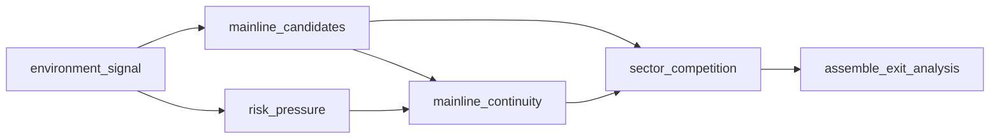

# Analysis Layer Workflow Graph Design

## 背景

当前仓库已经完成部分尾部 hook 化和执行链 stage 化，但 [`scripts/daily_report_entry_demo.py`](/Users/chaixixi/.hermes/hermes-skills/personal/a-daily-report/scripts/daily_report_entry_demo.py) 仍然承担过多“分析层大脑”职责，主要体现在：

- `get_daily_data()` 仍是单体型请求总控
- `build_mainline_exit_analysis()` 仍是单体型分析推导函数
- `generate_markdown_report()` 仍掌握较多中间态和装配职责

前一版设计已经把方向收敛到“外层按业务域，内层按推导节点”，但这还只是“模块化函数链”，还不是理想中的“流程图式节点系统”。

用户希望的最终形态更接近 Dify / 流程图节点编排：

- 一个分析流程由多个节点组成
- 节点之间通过边连接
- 单个节点可以替换、升级、禁用、删除、插入
- 问题可以定位到具体节点，而不是回入口文件读整段逻辑

因此，本 spec 升级为“图驱动节点规范”，把分析层正式定义成：

- 外层按业务域
- 域内以 workflow graph 描述节点关系
- 节点实现由 registry 绑定
- 执行由通用 graph executor 统一负责

## 目标

- 把分析层从“入口内联大函数”重构成“业务域 workflow graph + node registry + graph executor”
- 让最小可替换单元收敛到单个 node
- 让节点之间的依赖和顺序通过 graph 明确定义，而不是写死在 runtime 中
- 支持后续对节点做 CRUD、版本切换、禁用、替换
- 让 AI 和人工都可以在“不读完整入口文件”的情况下完成定位、替换和升级

## 非目标

- 本 spec 不要求第一阶段就做可视化拖拽编辑器
- 本 spec 不要求一次性把所有旧逻辑改成 DAG
- 本 spec 不改变日报格式作为第一优先级，兼容旧输出优先
- 本 spec 不在这一阶段引入跨进程微服务；先在 Python 进程内完成节点图治理

## 核心结论

后续分析层统一采用以下模型：

- 外层按业务域组织
- 域内流程按 workflow graph 描述
- 单个 node 是最小可替换单元
- runtime 只做 graph 调用封装
- registry 负责 `node_key -> implementation` 绑定
- executor 负责图执行、依赖排序、跳过、降级、日志汇总

也就是说，目标不再是“把函数拆小”，而是“把分析流程变成节点图”。

## 设计原则

### 1. Node 是最小可替换单元

后续替换、升级、修复优先发生在单个 node，而不是直接修改入口或整个业务域 runtime。

### 2. Graph 是流程真相

节点关系、依赖顺序、分支和汇合，必须以 graph 定义为准，而不是散落在 runtime 的硬编码调用顺序里。

### 3. Registry 是节点插槽层

同一个 `node_key` 后续可以切换到不同实现或版本，流程本身不需要同步大改。

### 4. Executor 是统一调度层

executor 统一负责：

- 拓扑顺序
- 依赖校验
- 节点跳过
- 降级执行
- 结果汇总
- 日志追踪

业务域 runtime 不再重复实现这些控制逻辑。

### 5. Contracts 是稳定边界

后续所有替换和升级，都以 node / workflow 契约为准，而不是以函数内部局部变量为准。

### 6. Trace 是标准层，不是附属品

每个 node 都必须产出结构化日志，保证后续快速排错。

## 推荐目录规范

```text
scripts/
  workflow_graph/
    node_contract.py
    workflow_contract.py
    registry.py
    executor.py
    run_store.py
    trace.py

  domains/
    market_state/
      contracts.py
      graph.py
      registry.py
      runtime.py
      trace.py
      nodes/
        infer_environment_signal.py
        infer_mainline_candidates.py
        infer_mainline_continuity.py
        infer_risk_pressure.py
        infer_sector_competition.py
        assemble_exit_analysis.py

    watch_candidates/
      contracts.py
      graph.py
      registry.py
      runtime.py
      trace.py
      nodes/
        infer_candidate_pool.py
        infer_candidate_score.py
        infer_candidate_filter.py
        assemble_watchlist.py

    execution_chain/
      contracts.py
      graph.py
      registry.py
      runtime.py
      trace.py
      nodes/
        infer_permission.py
        infer_position_sizing.py
        infer_action_plan.py
        assemble_execution_context.py
```

补充约束：

- `graph.py` 只描述当前业务域 workflow
- `registry.py` 只负责节点注册，不做业务推导
- `runtime.py` 只做 graph 调用封装和兼容旧入口 wrapper
- `nodes/*.py` 是真正的业务节点实现

## Workflow Graph 契约

每个业务域必须显式定义一个 workflow graph，至少包含：

```python
{
  "workflow_key": "market_state_v1",
  "version": "1.0.0",
  "entry_nodes": ["environment_signal"],
  "nodes": [
    {"key": "environment_signal", "kind": "infer"},
    {"key": "mainline_candidates", "kind": "infer"},
    {"key": "risk_pressure", "kind": "infer"},
    {"key": "assemble_exit_analysis", "kind": "assemble"},
  ],
  "edges": [
    {"from": "environment_signal", "to": "mainline_candidates"},
    {"from": "environment_signal", "to": "risk_pressure"},
    {"from": "mainline_candidates", "to": "assemble_exit_analysis"},
    {"from": "risk_pressure", "to": "assemble_exit_analysis"},
  ],
  "exports": ["exit_analysis", "risk_snapshot", "mainline_candidates"],
}
```

### Graph 最低要求

- 每个 node 必须有唯一 `key`
- 每条 edge 必须显式写出 `from -> to`
- graph 必须可拓扑排序
- graph 必须声明最终可对外暴露的 `exports`

### Graph 扩展能力

后续允许在不破坏主结构的前提下扩展：

- `enabled`
- `conditions`
- `fallback_to`
- `timeout_ms`
- `retry_policy`
- `version_alias`

## Node Registry 契约

每个业务域必须提供 registry，把节点 key 绑定到实现：

```python
{
  "environment_signal": "domains.market_state.nodes.infer_environment_signal",
  "mainline_candidates": "domains.market_state.nodes.infer_mainline_candidates",
  "risk_pressure": "domains.market_state.nodes.infer_risk_pressure",
  "assemble_exit_analysis": "domains.market_state.nodes.assemble_exit_analysis",
}
```

### Registry 作用

- 新增节点：向 registry 注册
- 替换节点：切换 registry 绑定
- 版本升级：把 `node_key` 指向新实现
- 灰度/回退：保留旧实现并切换 alias

这一步是节点“可替换”的关键，不允许把节点实现写死在 runtime 里直接 import 调用。

## Node 输入契约

每个 node 统一接收如下上下文：

```python
{
  "node": {
    "key": "risk_pressure",
    "workflow_key": "market_state_v1",
    "run_id": "..."
  },
  "inputs": {...},
  "state": {...},
  "upstream": {...},
  "helpers": {...},
  "config": {...},
}
```

定义如下：

- `node`
  当前节点元信息
- `inputs`
  当前 workflow 的原始输入
- `state`
  当前 workflow 已汇总的全局中间态
- `upstream`
  当前节点直接依赖的上游节点 exports
- `helpers`
  工具函数、兼容 wrapper、格式化器、转换器
- `config`
  阈值、开关、策略参数、实验配置

约束如下：

- 节点不能隐式依赖入口全局变量
- 节点不能直接读取不在 `inputs/state/upstream` 中的数据
- 节点尽量保持无状态、幂等

## Node 返回契约

每个 node 统一返回：

```python
{
  "value": {...},
  "exports": {...},
  "state_patch": {...},
  "module_logs": [...],
  "errors": [...],
  "control": {
    "status": "success"
  }
}
```

定义如下：

- `value`
  当前节点原始结果
- `exports`
  允许被下游依赖的稳定输出
- `state_patch`
  需要合并回 workflow 全局 state 的补丁
- `module_logs`
  当前节点日志
- `errors`
  非致命错误或降级信息
- `control`
  当前节点执行控制结果

### `control.status` 约束

统一使用：

- `success`
- `degraded`
- `skipped`
- `error`

### 返回值约束

- 下游优先消费 `exports`
- executor 统一合并 `state_patch`
- 可恢复问题优先写入 `errors` 与 `control.status=degraded`
- 真正不可恢复错误再进入 `control.status=error`

## Executor 职责

通用 graph executor 必须负责：

1. 校验 workflow graph 合法性
2. 根据 edges 计算执行顺序
3. 读取 registry 找到节点实现
4. 组装每个节点的上下文
5. 合并 `state_patch`
6. 缓存每个节点的 `exports`
7. 汇总所有 `module_logs`
8. 处理 `skipped / degraded / error`
9. 输出 workflow 级 exports

### Executor 输出

```python
{
  "workflow_key": "market_state_v1",
  "state": {...},
  "node_results": {...},
  "exports": {...},
  "module_logs": [...],
  "errors": [...],
}
```

## Node CRUD / Versioning 规则

这是本 spec 相比“模块化函数链”新增的关键能力。

### Add

新增一个 node，需要同时完成：

- 新建 `nodes/*.py`
- 在 `registry.py` 注册实现
- 在 `graph.py` 声明节点和 edges
- 补测试

### Replace

替换 node 时：

- 保持 `node_key` 不变
- 切换 registry 绑定实现
- 只要 exports 契约不变，下游无需大改

### Disable

禁用 node 时：

- 在 graph 上标记 `enabled=False` 或条件跳过
- executor 记录 `status=skipped`

### Delete

删除 node 时：

- 必须同步删除相关 edges
- 必须确认下游没有继续依赖该 node exports

### Upgrade

节点升级优先采用版本别名策略：

- 旧实现保留
- 新实现注册为新版本
- registry alias 再指向新版本

这样可以回退，不需要一次性覆盖旧实现。

## 统一日志契约

每个 node 至少产出如下结构：

```python
{
  "module": "domains.market_state.nodes.infer_risk_pressure",
  "node_key": "risk_pressure",
  "step": "infer.risk_pressure",
  "status": "success",
  "message": "已完成风险压力推导",
  "details": {
    "workflow_key": "market_state_v1",
    "input_keys": ["dt_pool", "a_kill_records"],
    "upstream_keys": ["environment_signal"],
    "output_keys": ["risk_snapshot"],
    "decision": "高位抱团风险升高"
  }
}
```

日志约束：

- `module` 必须是具体模块路径
- `node_key` 必须对应 graph 中声明的节点
- `step` 必须是稳定标识，不能再用 `step0/step1.1`
- `details` 必须包含关键输入、关键上游、关键输出和决策摘要

## 业务域 runtime 的定位

每个业务域仍然保留 `runtime.py`，但它不再写死整段推导逻辑，而是退化为 graph wrapper：

```python
def run_market_state_analysis(ctx):
    workflow = build_market_state_graph()
    registry = build_market_state_registry()
    return execute_workflow_graph(workflow, registry, ctx)
```

也就是说，runtime 不再是“分析大脑”，只是“调用 graph executor 的门面层”。

## `build_mainline_exit_analysis()` 的目标拆分

当前单体函数应被兼容式重构为：

```python
def build_mainline_exit_analysis(...):
    result = run_market_state_analysis(ctx)
    return result["exports"]["exit_analysis"]
```

### `market_state` graph 推荐节点

- `environment_signal`
- `mainline_candidates`
- `mainline_continuity`
- `risk_pressure`
- `sector_competition`
- `assemble_exit_analysis`

### 推荐关系图



### 节点职责

#### `environment_signal`

- 判断环境开关、强弱、防守/进攻状态
- 输出 `environment_signal`

#### `mainline_candidates`

- 从热榜、板块、资金、连板、异动中找主线候选
- 输出 `mainline_candidates`

#### `mainline_continuity`

- 判断主线是否具备连续性和延续条件
- 输出 `continuity_snapshot`

#### `risk_pressure`

- 汇总跌停、A杀、高位失败样本、结构风险
- 输出 `risk_snapshot`

#### `sector_competition`

- 归纳主攻线、次强线、竞争线
- 输出 `competition_snapshot`

#### `assemble_exit_analysis`

- 只做最终结构拼装
- 兼容旧入口和旧渲染逻辑所需格式
- 输出 `exit_analysis`

## 市场分析域稳定 exports

```python
{
  "environment_signal": {...},
  "mainline_candidates": [...],
  "continuity_snapshot": {...},
  "risk_snapshot": {...},
  "competition_snapshot": {...},
  "exit_analysis": {...},
}
```

要求如下：

- 下游尽量消费这些稳定 exports
- 旧逻辑迁移期允许 wrapper 消费旧格式
- 新模块不得继续扩大对旧局部变量的依赖

## 迁移策略

### 第一阶段：线性 graph 化

- 先把现有单体函数拆成 node
- graph 允许先保持线性或弱 DAG
- 重点是把顺序、依赖、导出显式化

### 第二阶段：域内 graph 固化

- `market_state` 先落地为完整 graph
- `watch_candidates` 和 `execution_chain` 逐步迁移

### 第三阶段：节点版本化

- 给关键 node 引入版本 alias
- 支持回退和切换实现

### 第四阶段：节点 CRUD 工具化

- 补充增删改查所需的辅助工具或脚本
- 但不强制本阶段就做图形化编辑器

## 推荐实施顺序

1. 先重构 `market_state`，把 `build_mainline_exit_analysis()` 迁移成 graph wrapper
2. 再重构 `watch_candidates`
3. 再把 `execution_chain` 剩余入口内判断迁移成 graph node
4. 最后继续压缩 `generate_markdown_report()` 和 `get_daily_data()`

## 验证要求

每拆一个业务域，至少满足以下验证：

- graph 可通过校验
- 该域新增单元测试覆盖核心 node
- registry 能正确定位节点实现
- node logs 可定位到具体节点
- 旧入口 wrapper 行为保持兼容
- 旧输出结构不因 graph 化而破坏

## 成功标准

满足以下条件可视为设计落地成功：

- 新增分析逻辑优先以 node 形式进入某个业务域 graph
- 节点顺序和依赖不再散落在入口函数里
- 任意一个分析问题都能定位到“哪个 workflow、哪个 node、哪条 exports”
- 替换某个判断逻辑时，不需要同步重写整个入口文件
- AI 可以仅基于某个域的 graph、registry、contracts 和 tests 完成局部修改

## 决策结论

本仓库后续分析层统一采用“图驱动节点规范”：

- 外层按业务域
- 域内以 workflow graph 表达节点关系
- node 是最小可替换单元
- registry 负责节点绑定
- executor 负责统一调度
- contracts 负责稳定边界
- trace 负责结构化日志

这份 spec 作为后续拆解 [`scripts/daily_report_entry_demo.py`](/Users/chaixixi/.hermes/hermes-skills/personal/a-daily-report/scripts/daily_report_entry_demo.py)、迁移分析逻辑、统一日志和节点契约的正式规范。
