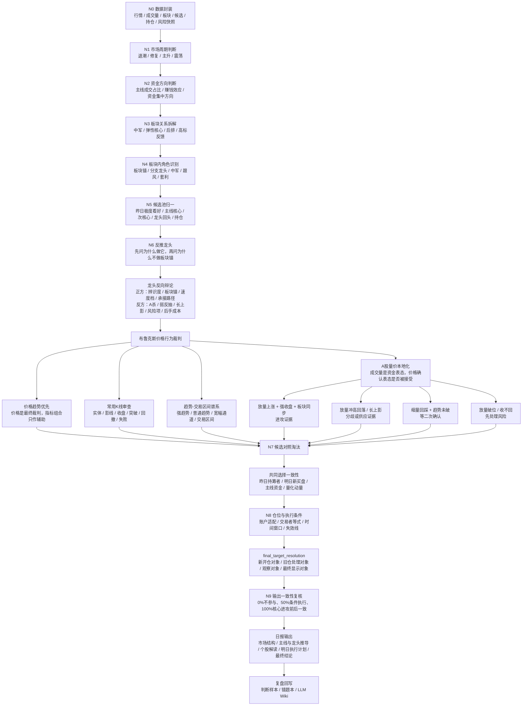

# Brooks Price Action And A-Share Volume Localization

## Goal

Capture the local trading contract for combining Al Brooks' price-action-first
method with this project's A-share daily-report selection logic.

The outcome is not a new indicator stack. The outcome is a smaller decision
rule:

- price trend and common K-line behavior remain the final judge;
- volume is treated as A-share capital-expression evidence;
- volume can raise attention and identify who is acting, but participation still
  requires price follow-through, sector context, account fit, and the fixed
  execution windows.

## In Scope

- LLM Wiki knowledge for Brooks-style price action localized to A shares.
- Compact context mappings used by `build_llm_wiki_context()`.
- Explainable LLM Wiki routing terms for questions about volume, amount, and
  capital expression.
- Narrow tests proving the wiki and routing contract are present.

## Out Of Scope

- Changing candidate scoring weights.
- Adding a new volume indicator model.
- Changing report generation runtime or replay data sources.
- Expanding execution windows.
- Treating Brooks' method as a full replacement for sector-anchor reversal,
  leader debate, or final target resolution.

## Non-Goals

- Do not build a "perfect stock" filter requiring every learned condition to
  pass.
- Do not make volume a standalone buy reason.
- Do not make indicators a substitute for price trend, common K-lines, and
  follow-through.

## Design

### Principle

Brooks' method says the chart already reflects the market's judgment, and
indicators are mostly transformations of price. In highly liquid U.S. futures,
he can often trade with K-lines and a 20-period moving average.

This project keeps that principle but localizes it for A shares:

- `price_is_final_judge`: price trend, K-line close, breakout, pullback, and
  failure decide whether the market accepted the idea.
- `volume_is_capital_expression`: volume shows whether funds are acting, but it
  must be interpreted through price consequence.
- `indicator_combo_downgrade`: MACD, KDJ, custom combinations, and pretty
  factor stacks cannot create participation by themselves.
- `volume_first_for_attention_not_action`: volume may be checked early to find
  capital attention, but action comes only after price confirmation.

### Volume-Price Quadrants

| Situation | Interpretation | Action Contract |
|---|---|---|
| Volume expansion + rising price + strong close + sector sync | Funds are attacking and price accepts the attack | Can enter comparison for participation if account and window fit |
| Volume expansion + upper shadow / fade / failed close | Funds acted, but supply or disagreement appeared | Downgrade to observation or existing-position risk handling |
| Shrinking-volume pullback + trend still intact + reclaim | Healthy digestion or controlled pullback | Watch for second confirmation, not automatic buy |
| Volume expansion + breakdown / failed reclaim | Active sell pressure or stampede risk | Risk first; do not use cheap price as a reason |
| Sudden low-position volume expansion | Funds started to express interest | Research and observation priority only; needs follow-through |
| No-volume rise or one-line limit-up | Result is strong but tradability is poor | Treat as leader/sector evidence; do not assume executable entry |

### Integration Point

The daily-report selection path remains:

```text
market cycle -> mainline/sector path -> sector-anchor reversal -> leader debate
-> Brooks price-action judge -> common-selection consistency -> account/time/risk
-> final_target_resolution
```

The localized volume rule enters inside `Brooks price-action judge`. It does not
replace `sector-anchor reversal` or `leader debate`.

## Brooks A-share Volume-Localized Selection Flow



### Wrong vs Correct

Wrong:

```text
Volume expands -> funds are in -> buy.
```

Correct:

```text
Volume expands -> funds expressed interest -> check price consequence:
strong close, follow-through, sector sync, account fit, fixed window, and
invalidation. Without those, it remains observation.
```

Wrong:

```text
Brooks ignores volume -> A-share reports should ignore volume.
```

Correct:

```text
Brooks downgrades indicators because price is the final judge. A-share volume is
not promoted above price; it is used as capital-expression evidence that still
needs price acceptance.
```

## Done Definition

- Wiki records the Brooks/A-share volume relationship.
- Context mappings include price-first, volume-as-capital-expression, and
  volume-price quadrant rules.
- Router can match volume/amount/capital-expression questions to the Brooks
  price-action node.
- Tests verify the contract.

## Verification

Run:

```bash
.generated/venv-py314/bin/python3.14 -m unittest tests.test_llm_wiki_context tests.test_llm_wiki_router
```
